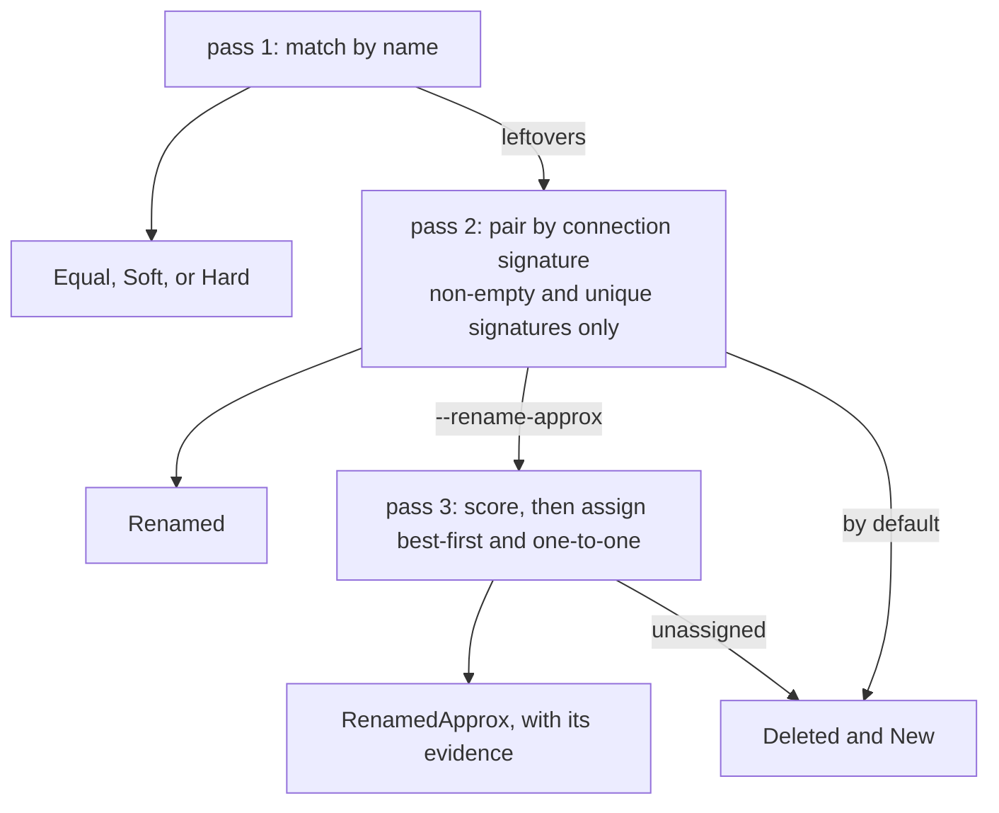

Two revisions of a schematic rarely differ in a way a text diff can explain. Every export
renumbers internal ids, reflows the file, and rewrites coordinates, so a line-by-line
comparison reports almost the whole file as changed. The diff engine works one level up. Both
revisions are read into the neutral intermediate representation, and the engine compares the two IR
designs and classifies what changed. Because it runs on the neutral IR, the same comparison
works over any format that reads into it, whether EDIF, KiCad, or IPC-2581. The output says
what changed and how much it matters, not merely that the files differ.

Three passes produce that answer.



## Identity strategy

Matching entities across revisions uses semantic keys, never the format-native id. A native id
is regenerated on every export, so matching on it would report the entire design as changed.

- Components match by {{ explainable "reference-designator" }}.
- Nets match by name.
- When a net's name changes, the diff recovers it by its connection signature. That signature is
  the canonical sorted set of `refdes.pin` endpoints on the net. If the endpoints are the same, it
  is the same net under a new name.

The rename case is the familiar problem of a renamed variable. A textual diff sees a deletion
and an addition. Matching on what the variable connects to recovers the rename instead.

## Change taxonomy

A hand-run {{ explainable "netlist" }} comparison already uses these categories, and the
classification mirrors them.

| Class | Meaning | Impact |
|---|---|---|
| Equal | net matched by name, identical connectivity and attributes | none, not reported |
| **Soft** | matched, connectivity identical, only attributes differ (for example `net_class`) | cosmetic |
| **Hard** | matched, connectivity (pin membership) changed | electrical |
| **Renamed** | same connectivity, different name | a rename, not a delete plus add |
| **New** / **Deleted** | present on only one side, and not a rename | structural |

Components report Added, Removed, or Changed, where Changed covers the part-reference set and
the `Value`, `dnp` and `Footprint` attributes. A [rule](../rules-and-checks/) evaluating the
diff decides whether a given change is acceptable, and the diff itself never does.

## Rename detection

After matching by name, the leftover deleted and added nets are paired by connection signature.

```
delBySig = { signature -> name }  for deleted nets, keeping only signatures that are
                                   non-empty AND unique within the deleted set
addBySig = same, for added nets
for each signature in delBySig that also appears in addBySig:
    -> Renamed{ from: delBySig[sig], to: addBySig[sig] }
leftover deleted -> Deleted ;  leftover added -> New
```

Two unrelated nets can happen to share a connection set, and two empty nets share the empty
one. Requiring a signature to be unique and non-empty stops either pair from being mispaired as a
rename. When a signature is
ambiguous this pass declines to guess and leaves the nets for the pass below.

### Near matches, off by default

Exact pairing has a cliff. A revision that renames a net very often changes it slightly too. The
rename comes with a {{ explainable "decoupling-capacitor" "decoupling cap" }} added, a
{{ explainable "test-point" }} dropped, or a series resistor inserted. One endpoint moves, the
signature no longer matches, and the diff reports the rename as an unrelated deletion beside an
unrelated addition. You needed that rename recovered more than any other.

`--rename-approx` adds a third pass. It runs over the nets the exact pass could not place. It is a
separate ranked assignment rather than a loosened version of the exact pass. It runs second, so a
rename with no connectivity change still reports as an exact `renamed` rather than as a guess.

```
for each leftover deleted net with enough SIGNIFICANT endpoints:
    candidates = new nets sharing at least ceil(min_old_coverage_significant * n) of them
    score each candidate, rejecting any that fails a threshold
rank every surviving pair, assign best-first, one-to-one, no reuse
    -> RenamedApprox{ from, to, added, removed, evidence }
```

{{ includeFile "figures/net-rename-approx.svg" }}

Endpoints are not equal. A test point coming or going is routine churn and should not cost a net
its identity, while a device pin moving should, so the thresholds come in significant and
all-endpoint pairs. Significance is read from `Component.device_classes`, the normalized set
stamped at ingestion, rather than from how a ref des is spelled.

The pass is **off by default** because it ASSIGNS a best match among candidates rather than
recovering a fact. A wrong pairing claims a net kept its identity across a revision when it did
not, and every downstream reading inherits that claim. So a `renamed-approx` is a distinct kind, a
consumer can filter on it, and it carries the arithmetic that produced it. A reader has to be
able to disagree.

| knob | default | what moving it trades |
|---|---|---|
| `MinOldCoverage` | 0.70 | fraction of the old net's endpoints that must survive. Lower catches heavier rewires and starts pairing nets that merely overlap. |
| `MinOldCoverageSignificant` | 0.80 | the same over significant endpoints. This threshold does most of the work, because probe churn cannot move it. |
| `MinNewCoverage` | 0.35 | fraction of the new net made of old endpoints. Guards a large net swallowing a small one. |
| `MinNewCoverageSignificant` | 0.60 | that guard over significant endpoints. |
| `MaxAddedSignificantFloor` | 2 | how much a net may grow and still read as itself, when half its old significant count is smaller. The floor lets a two-endpoint net become four. |
| `MinSignificantEndpoints` | 2 | below this a net has no shape to match on. |
| `InsignificantClasses` | `[test_point]` | which device classes are excluded from the overlap arithmetic. |

These numbers are a calibrated starting point rather than a proven one. Produce a precision number
on a revision pair that matters before trusting the pass on it, per
[evidence](../../build/evidence/).

<details>
<summary>Where the numbers came from, and the one threshold that behaves unlike the rest</summary>

They are the settled values of a netlist comparison tool that has run against real revision pairs
for years. Both failure directions showed up while those values were tuned. Looser values
mis-paired unrelated {{ explainable "rail" "power rails" }}, and tighter values missed obvious
renames where one decoupling capacitor had been added or removed.

`MinNewCoverage` counts ALL endpoints, so a small net that gains enough test points can fall under
it even though every significant threshold is satisfied. On a two-endpoint net, three added probes
pair and four do not. The significant thresholds insulate the pass from probe churn and this one
does not.

</details>

## Provenance-annotated findings

Every net finding carries the net's source locator in each revision, the `source_file` and
`native_id` on each side, nil on the side where the net does not exist. A reader can then trace a
finding to where the net sits in the old file and where it sits in the new one. The
annotation is keyed by the semantic match, not by the native id.

## Hard cases

- The signature pairing above handles a net rename. The opt-in near-match pass beside it handles
  a rename that also changed the net.
- A component can be renamed from `R1` to `R5` with the same part and connections. This
  reference-designator renumbering is the component analogue of a net rename, and it is not yet
  detected.
- A reroute can wire the same endpoints through different copper. Such a reroute is electrically
  identical, and a netlist diff cannot see it by design, because routing is geometry rather than
  connectivity.
- Nets with no reference designator, such as power and ground, are stable only if the reader
  emits stable keys for them. So are {{ explainable "bus" }} or member pins. Unstable keys would
  surface as false Hard changes.
- An ambiguous rename signature is reported as New and Deleted by the exact pass, never guessed.
  With `--rename-approx` it may instead be assigned as `renamed-approx` with its evidence
  attached. That is a different claim, and a consumer can filter it separately.

## How it is checked

A hand-built revision pair in the unit tests exercises every class (Hard, Soft, Renamed, New,
Deleted, Equal) and the provenance annotation. Beyond that, `agni diff` is run on a real corpus
pair with genuine rewires to confirm the classification holds on real tool output.

## Not handled yet

- Provenance on component findings. Nets carry it today, components do not.
- Component rename detection, the reference-designator renumbering case above. It is the same
  scoring problem with a different key. When a second caller appears, generalise the near-match
  pass over "entity with a signature" rather than reimplementing it.
- Near-match thresholds are a `diff.RenameOptions` value passed to the engine. The CLI sets only
  whether the pass runs, and no project config tier carries the thresholds yet, so a house cannot
  declare its own and have every run pick them up.
