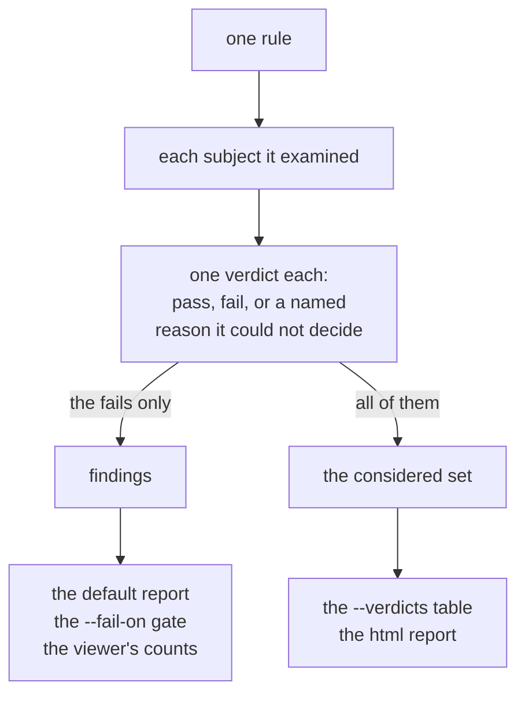

[Getting started](../getting-started/) ran the whole catalog and read the first few
findings. This page covers narrowing the report to what you care about, reading
it in different shapes, and following a finding back to what the tool actually saw.

Each rule looks at a set of subjects and reaches a conclusion about each one. Everything below
is a view onto those conclusions:



## Where these commands run

The commands below name their sample with no path in front of it, so run each one from the
directory that holds its sample. Two samples appear, both checked into a clone of the engine repo:

| Sample | Run from | What it is |
|---|---|---|
| `showcase.fires.*`, `showcase.passes.*` | `demo/` | one small board that trips several rules, and its clean twin |
| `designs/gateway` | `examples/tutorial-project` | the tutorial's synthetic board, with a team's checklist wrapped around it |

So the `agni check` lines below assume you are standing in `demo/`:

```
git clone https://github.com/panyam/agni
cd agni/demo
```

Point the same commands at your own board instead and nothing else changes.

## Narrow what runs

By default every rule runs. Two flags cut that down.

Run one rule by name with `--rule`, which is repeatable:

{{ agniRun "content/guide/runs/rule-filter.yaml" }}

Run a whole group by tag with `--tag key=value`, also repeatable. Every rule carries catalog tags
(category, tier, and more), so you can run one family at a time:

{{ agniRun "content/guide/runs/tag-filter.yaml" }}

Nine rules ran instead of the whole catalog, and the last line says so.
`--tag category=connectivity` runs the connectivity group, and so on. Combine `--rule` and `--tag`
to build exactly the set you want.

## Read the report in the shape you need

`--format` takes six values, and the first five are the findings report in different shapes:

| `--format` | what you get |
|---|---|
| `text` (the default) | a per-rule summary |
| `markdown` | a severity-organized report, worst first, for pasting into a review |
| `csv` | one row per finding |
| `json` | one object per finding, for tooling (see provenance below) |
| `report` | the same report as JSON, the wire shape the web viewer consumes |
| `html` | a self-contained page, and the one form that reports the considered set rather than the violations alone ([below](#the-html-report)) |

The markdown one:

{{ agniRun "content/guide/runs/markdown-report.yaml" }}

The header line reads `11 finding(s), 81 rule(s) run`, and it is your coverage receipt. It says
how many rules actually ran, so you can tell a clean report from a report that had little to
check. See "silence is not a pass" in [Concepts](../concepts/).

## See what was checked, not only what failed

A findings report lists violations, so a clean subject says nothing at all. You cannot tell it
apart from a subject that no rule looked at. `--verdicts` answers the other question:

{{ agniRun "content/guide/runs/verdicts.yaml" }}

The table groups by rule and tallies each one, so `i2c-pull-up` reports one fail and one pass rather
than one finding and a silence. `/SDA` is fine. The table says so, and names the resistor and the
{{ explainable "rail" }} holding it up. A findings report cannot print that line.

`not-considered` is the third answer. `esd-clamp-not-tvs` reaches `/USB_D+` and `/USB_D-` and
declines. Those nets carry no clamp at all, so the rule has no device class to judge. It names
`esd-protection` as the rule that reports them. A findings report shows those nets exactly as it
shows a net that passed.

It honours `--format text|csv|json|html`, and `--format html` turns it on by itself, since the HTML
report has no findings-only form. The CSV carries a `verdict_id` per row
(`i2c-pull-up:(net:/SDA)`), plus `context` (the entities to look at, as `role=ref` pairs) and `terms`
(the values behind a conclusion):

{{ agniRun "content/guide/runs/csv-verdicts.yaml" }}

That is one rule out of the table. The full table runs to about 150 rows on this board.

Narrowed to one rule, the same table is a bus sign-off sheet.
`agni check <design> --rule i2c-pull-up --verdicts --format csv` (or `--format html`) gives one row
per I2C net that the rule considered, passing and failing alike. A pull-up one resistor away reads
`SDA reaches rail VCC_3V3 through R1`. One behind a series part names every net on the way, as
`SCL reaches rail VCC_3V3 along SCL -> [R2] -> BUF_NET -> [R3] -> VCC_3V3`, in the same
route spelling `agni trace` prints. A failing row states the hop limit of its search, since a
pull-up four hops out is a different problem from no pull-up at all.

Paste an id into a running viewer as `?verdict=<id>` and it opens on that verdict with the proof
drawn, with the subject in focus and the resistor and rail behind it.

**It is a separate table, not extra rows.** `--format csv` without `--verdicts` is unchanged, so
anything already reading the findings CSV keeps working and never sees a pass counted as a defect.

**Only some rules report one so far.** When a rule is missing from the output, it is declining to
say what it looked at. That differs from reporting that it looked at nothing. Expect the table to be
thin until more of the catalog converts.

## Follow a finding to its source

Every finding carries **provenance**, a record of exactly what the tool saw, and `--format
json` exposes it:

{{ agniRun "content/guide/runs/json-provenance.yaml" }}

- `subject` is what the finding is about, either a `net` (`/SCL`), a `component` (its
  {{ explainable "reference-designator" "ref des" }}), or a component `pin`.
- `provenance.sourceFile` is the file the fact came from. For datasheet-backed rules the
  message also names the datasheet page and table (see [Datasheets](../datasheets/)).

So you never have to take a finding on faith. Each finding points at a net, pin, or
datasheet row, and you can go open it yourself.

### Start from the thing instead of the finding

In the viewer you can also go the other way. Click a part, a net or a {{ explainable "bus" }}, on
the drawing or in a query result, and the selection bar tells you how many findings already name it,
split by severity.
Clicking that count opens them in the checks panel. A query's results footer does the same for every
entity the query returned at once, so "what is flagged on the twelve things I just searched for" is
one number.

Nothing re-runs when you click. The bar filters the findings of the run you already have, so they
always agree with the report beside them.

Two things sit beside the count rather than in it. **"N unresolved"** means a rule examined this
thing and could not decide. An unresolved answer is never a pass and never a failure. The message
says what the rule could not resolve, and often you can clear it by supplying that. **"N rule(s)
could not run"** means some selected rules were gated on this whole design before they evaluated, so
they report nothing anywhere. Hover for which and why.

**Read the wording, not just the number.** A count is only meaningful once the rules have actually
run, so the bar says "not checked yet" rather than "no findings" before you press Run, and reports a
half-finished run as a floor ("2 so far").

A count beside one entity is also narrower than a report, and the bar says so on screen. The count
covers only the rules you have selected, and only findings that name that entity. A rule about the
whole design has no single subject and will never appear there. A rule comparing two pins is filed
under one of them, so the other pin looks quiet in the count even though the finding names it.

The finding itself does say so. A message that names an entity other than its subject carries that
entity as a chip you can click, so you can get from the sentence to the other end. An entity view
tells you where to look and says nothing about whether anything is fine.

## Understand a rule

Each rule ships with a short explainer describing what it looks for and why the condition
matters electrically. In the viewer it appears beside the finding. On the command line you
look it up by the rule name. The catalog is open, so your team can add house
rules on top of the built-ins. [Naming conventions](../naming-conventions/) is the simplest
form of that, configured without any code, and [interface profiles](../interface-profiles/)
are the same idea for a bus, where you declare its signals and get a rule per requirement.

Here is one, in full, so you know what to expect before you go looking. Every rule in the
[rule catalog](../../reference/rules/) carries the same shape: what it checks, why it matters in the
circuit, and what its silence does and does not mean. Read that last part
before you trust a green result.

<details>
<summary><strong><code>cap-voltage</code></strong>, a capacitor's rating against the rail it sits on</summary>

{{ includeCard "content/reference/rules/cap-voltage.md" }}

</details>

A rule that could not evaluate never reports a pass. It reports not-applicable, needs-data, or
inconclusive, each naming what was missing. A clean report from this tool is worth something only
because of that distinction. For the same reason, the cards spend as much space on absence as on the
check itself.

## Gate a build

`--fail-on <severity>` exits non-zero when any finding sits at or above the threshold, so
`check` gates CI:

{{ agniRun "content/guide/runs/gate-severity.yaml" }}

and its passing twin:

{{ agniRun "content/guide/runs/gate-severity-clean.yaml" }}

That gate reads **severity**, and severity is a statement about consequence. The section above
separates a check that decided from one that never ran, and severity says nothing about that
distinction. Suppose a design's datasheet corpus moves. The design keeps passing this gate, because a
rule that could not evaluate produces no findings, and no findings looks like clean.

`review` gates on the other axis:

```
agni review designs/gateway --checklist review --fail-on-outcome fail
agni review designs/gateway --checklist review --min-answered 13
```

`--min-answered` counts the items that produced an answer (`pass`, `fail`, `provisional`,
`computed-n/a`). That count is stricter than the covered count, which the report also prints.
Covered subtracts only `not-automated`, so an item whose rule is present and whose inputs are gone
still counts as covered. Both gates are off by default, and a tripped one exits `2` where a failed
run exits `1`. See the [CLI reference](../cli-reference/#gating-a-pipeline-on-a-review) for the full
vocabulary.

## The HTML report

`agni check --format html > report.html` writes one self-contained page showing what each rule
looked at, what it concluded, and what to do about the parts that failed.

    agni check --format html \
      --server http://localhost:8080 \
      --mount board=. mount://board/design.kicad_sch > report.html

Rules with something to act on come first and open expanded, and rules that cleared everything collapse to
a one-line summary you can expand to check their working. The ordering exists because a board
with three problems and two thousand passes has to show you the three problems.

**A design that declares an IO map gets a section per device ahead of the rules**, one row per
declared pin with its function, the net the netlist puts there, the route to its far end and each
IO-map rule's outcome. [Design intent](../design-intent/#reading-the-map-one-pin-at-a-time) shows
the layout.

**`--query-sets` adds the project's query sets after the rules**. The design's project keeps its
sets under `queries/`. Each set gets a Queries section, answered over the same read that the checks
used. A review often wants the checks beside its own tables (a pin list, a ratio sheet). The flag
puts both in one file attached to the review, rather than two exports merged by hand (agni issue
1190). The sections render as `agni query --set <name> --format html` renders them, and a project
keeping no sets gets the checks alone with a note on stderr.

    agni check --format html --query-sets designs/demo-board -o combined.html

**Some rules report violations without stating what they examined, and the report labels them as
such**. Their rows are captioned "absence here is not evidence of correctness". A failure list and a
considered set are different kinds of answer. Presenting them side by side as one kind would claim
coverage that the rule never checked, and a report would make that claim look most convincing.

**Links are emitted only when they are real.** `--server` says where the viewer is. Against a URL,
the mount must also be DECLARED, with `--mount` or in `agni.yaml`, rather than minted for this run.
A minted name means nothing on a server that was not started with it. So a run on a minted mount gets
no links, rather than links that resolve on nobody's server. Either way the reason is printed.

`--server self` makes a declared mount unnecessary. One process reads the design and serves it. The
links name that process's own mount table, so a minted mount is as linkable as a declared one. It
blocks until Ctrl-C, because its links resolve for exactly as long as its server is up.

<details>
<summary>What the server is asked, and the three answers it can give</summary>

Declaring the mount says the operator named it. That does not mean the server agrees about it, so a
`--server <url>` run also asks that server for its mount table. If the server serves the name from a
different root, every link would open a different board, so those links are dropped. If the server
does not answer, the question is still open. The run keeps the links and says they went unverified.
That way a report written before the viewer is up still gets its links.

A report with no links used to look like a broken renderer, because nothing named which half was
missing.

</details>

**Each link also carries the design's content hash**, so the viewer can say a link was computed
against different bytes rather than silently highlighting whatever now sits at that subject.

**A link names the design's declared ENTRY, not the argument you typed**, and so does its hash. Both
halves come from one resolution, so pointing `check` at the design folder, at a declared companion, or
at the entry file produces the same link. The viewer cannot open a folder, so a link built from the
folder argument used to load nothing at all. And a companion has
its own bytes, so a link built from the companion argument used to carry the entry's hash and read as
a revision mismatch on a design that was in sync.

When the viewer opens such a link, it compares that hash against the revision it just read. It
reports the result before it draws anything. A match is silent. Different bytes get a banner saying
the highlight may be about a different net. A verdict id is built from a rule name and a subject ref,
so it resolves against an edited design just as readily. If the server could not hash the file, the
link gets its own weaker banner rather than the benefit of the doubt, since a link nobody could check
has not been checked.

**A link also names its rule and the verdict's nets, parts and pins**, as `rule=` and `subject=`.
`subject=` uses the spelling `--subject` takes. The viewer then asks that one rule about those
subjects alone rather than running the catalog over the whole board. Both are hints on top of the
verdict id. A link without them still opens the same verdict by running the whole rule. Links in a
report saved before the hints existed work that way. So does a link whose design has changed so much
that the scoped answer no longer holds the verdict.

Don't assemble all of this by hand. `agni open <design>` serves the board and prints the matching
`agni check --mount … --server …` line. One process mints the mount and serves it, so the two cannot
disagree.

**A report on a hierarchical design says that its counts cover the top level alone.** The EDIF
reader extracts a hierarchical `.edn`'s top cell and skips the sub-cells it places, so every finding
and every count on the page describes the top level. The check report and the checklist page both
state this in their header, above the counts. They use the same sentence the CLI prints on stderr:

    hier.edn is hierarchical and only its top cell was read. 1 sub-cell holding 1 instance was not extracted (SUB: 1). Counts and checks cover the top cell alone.

It names the five largest skipped cells and totals the rest. The list travels with the run
(`CheckDesignResponse.unexpanded_hierarchy`, and the results document's `design` record), so a
report saved later from the viewer says it as well. A flat design gets no such line. With
`--flatten-hierarchy` (`Snapshot.flatten_hierarchy` on the wire), the read covers the whole schematic
and the line goes away. The line remains if a block places itself, because the walk stops there. The
markdown and text output carry no header band, so on those formats only the stderr note says it.

The page needs no JavaScript and loads nothing from the network, so it survives being emailed,
committed, or opened from a `file://` path.

## Save a report from the viewer

Once every selected rule has run, the checks panel offers **Save report** and **Save JSON**. Save
report downloads the same page that `agni check --format html` writes. Save JSON downloads the
results document that `agni check --results-out` writes. `agni results` can re-render that document
later, and the document names the engine build that produced it. Neither button runs anything again.
The engine renders the run that the panel already holds. It goes through the same code the CLI
calls, the `RenderCheckReport` rpc, so a saved file and the CLI's differ only in when they were
written and in how each names the design.

**Save CSV** downloads two files, `<design>.findings.csv` and `<design>.verdicts.csv`. Their rows
match what `agni check --format csv` and `agni check --verdicts --format csv` write. The engine lays
the run out as tables (the `Tabulate` rpc) and writes them (the `Encode` rpc), with the same code
the CLI uses. So both guard any cell that a spreadsheet would read as a formula. The rows are in the
panel's rule order, which can differ from the CLI's, and are otherwise the same. The **Tables**
panel shows the same run as tables before you save, one tab per table, and saves whichever is on
screen.

The **Review** panel's **Save report** does the same for a checklist run. It downloads
`<design>.agni-review.html`, the page `agni review --format html` writes. The page lists the
checklist's items in the manifest's order, with every finding behind each. The engine renders the run
that the panel shows, through the `RenderReviewReport` rpc. The CLI's `--format html` calls the same
rpc, so nothing is scored again and the two pages differ only in when they were written and in how
each names the design.

Each finding on the checklist page links to its source verdict, by the id the run stamped on it. So
the link opens the same proof as the check report's row for that verdict. Some rules state no
considered set, such as a query that declares no domain. A finding from one of them has no verdict to
open, so the page lists it without a link.

On the browser-only demo the engine runs in the page, so saving a design you dropped sends nothing
anywhere. Its rows link back into the viewer you saved it from. A design opened from your own files
gets no links, and the page says why, because the browser keeps those files only in the tab that
opened them.

## Where to go next

- [Datasheets](../datasheets/) turns on the rules that compare your design against a part's
  real limits.
- [Comparing revisions](../comparing-revisions/) diffs two versions of a design.
- [CLI reference](../cli-reference/) has every flag in one place.
