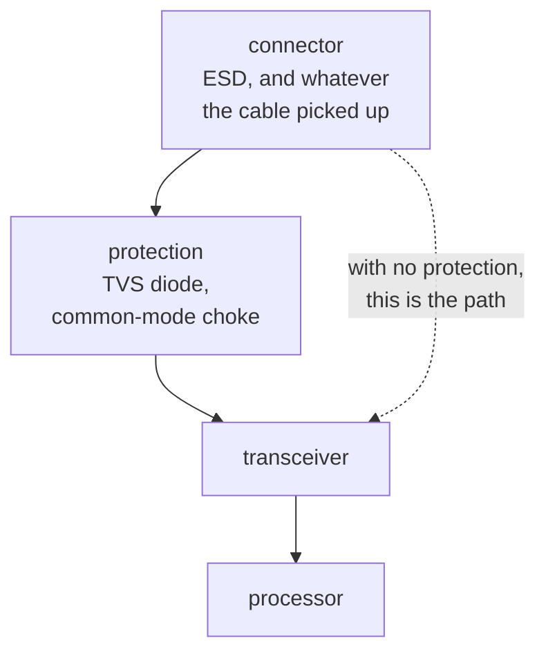

Anything leaving the board through a connector is exposed. A cable is an antenna, and a person
touching the connector is a static discharge of a few kilovolts arriving at a pin rated for a few
volts.

Protection is any part placed at the connector to absorb that before it reaches anything expensive.
A TVS diode or diode array absorbs the discharge, and a common-mode choke or ferrite absorbs the
interference.

The ordering is the point. Protection has to sit between the connector and the part it defends, so a
board that has the right parts in the wrong order has no protection at all, and nothing in the netlist
distinguishes the two.

So a profile declares protection rather than the engine inferring it, the same as
[termination](../termination/).

The course teaches it in [chapter 10](../../../learn/10-interfaces-and-what-they-require/), which
treats a bus as a contract.
