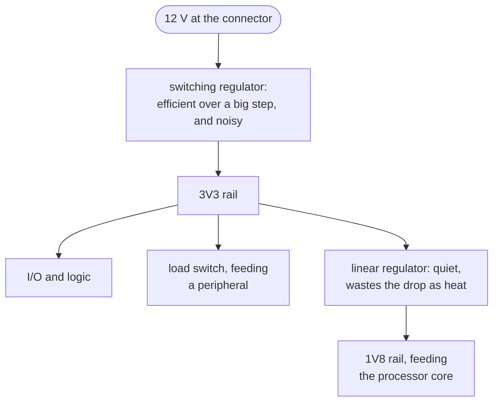

Power arrives at a board as one voltage and has to become several, because the parts do not agree
about what they want. A processor core might run at 1.8 V, its I/O at 3.3 V, and a motor driver
straight off the 12 V input. The power tree is the chain of regulators that does the converting.

There is a reason to stack the stages rather than run every regulator straight off the input. A
switching regulator holds its efficiency across a big voltage step, at the cost of electrical noise.
A linear regulator throws away the voltage it drops as heat. That waste is reasonable only over a
small step, and the linear regulator is quiet. So the common shape is a switcher doing the heavy
lifting and a linear part cleaning up whichever rail feeds something sensitive.

The tree matters because the system-level questions are asked about it. One asks whether a rail can
supply everything hanging off it. Another asks what order the rails come up in, and a third asks
what a part reads while they do. Each is a question about the cascade rather than about any one part
in it.

None of it is recoverable from a netlist. Nothing in a connectivity graph states that a rail was meant
to be 3.3 V, how much current its loads draw, or which stage is supposed to feed which. The rail's
name says the voltage, and a name is a convention somebody followed rather than a measurement. So the
tree is declared beside the design, in its `nets` (each rail's voltage and peak draw) and
`sequences`, and the checks compare the board against the declaration instead of against physics.

Five rules read it. [`intent-rail-current-capacity`](../../rules/intent-rail-current-capacity/) asks
whether the supplying part's rating clears the rail's declared peak, and
[`intent-rail-current-margin`](../../rules/intent-rail-current-margin/) asks whether it clears it with
headroom. [`intent-load-switch-trip-below-budget`](../../rules/intent-load-switch-trip-below-budget/)
catches a load switch set to trip under the rail's budgeted current, so the protection becomes the
fault. [`intent-sequence`](../../rules/intent-sequence/) checks the declared power-up order against
the enable chain in copper. And
[`regulator-output-exceeds-abs-max`](../../rules/regulator-output-exceeds-abs-max/) needs no
declaration. It catches a stage driving a rail above what a part downstream can survive, and that is
a fact about two datasheets.

The course teaches it in [chapter 8](../../../learn/08-the-power-tree/), which is the whole chapter
about it, and
[A board is fed by a cascade](../../../learn/08-the-power-tree/#a-board-is-fed-by-a-cascade-ee6)
reads one off the tutorial board's regulators.
[Chapter 9](../../../learn/09-sequencing-and-straps/) covers the order in which the tree comes up.
