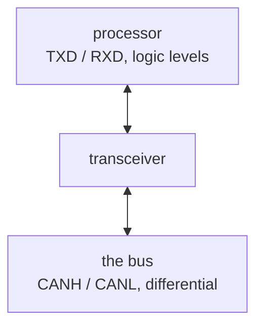

A processor talks in logic levels, a pin at 0V or at its rail. A bus standard rarely does. CAN uses a
differential voltage across two wires, RS-485 uses another, USB another again, and a
general-purpose logic pin can neither drive nor safely receive any of them.

The transceiver sits between the two and translates.

So a bus interface is three or four nets at the processor and two on the connector. A board can
also carry a bus without the processor knowing anything about the bus's electrical spec.

Because it faces the outside world, a transceiver usually also carries the bus's
[protection](../port-protection/), or sits directly behind it.

The course teaches it in [chapter 10](../../../learn/10-interfaces-and-what-they-require/), which
covers what an interface requires beyond two wires.
