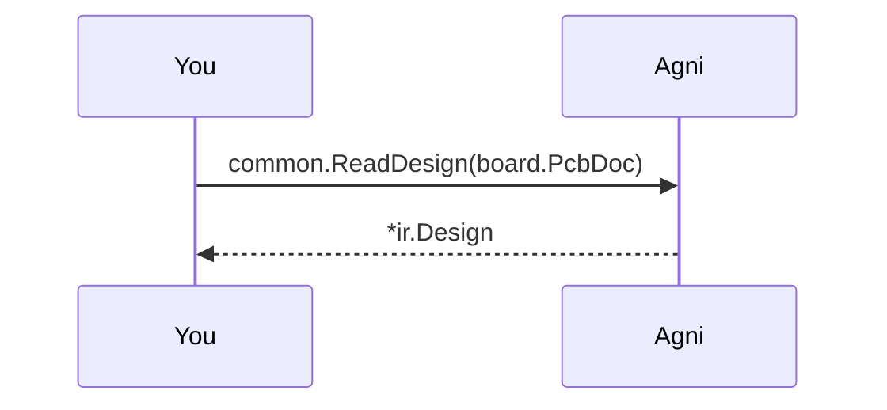

## An Altium board, read as it is saved

Altium boards usually reach other tools as an ODB++ or IPC-2581 export, and someone with an Altium licence has to make it. Agni reads the `.PcbDoc` itself, so you can check a board you were only sent.

The native file also carries more than the export. Each part keeps its schematic parameters, its part number and its description among them, which the ODB++ export drops.

## Pick a board {#pick}

> The default is the foxBMS master board, a public board from Fraunhofer IISB (CC-BY-4.0; this uses parts of foxBMS) that `make samples-oracle` fetches into tools/samples/. No synthetic Altium board can be made without Altium, so this example reads a real one. Give the path to your own binary .PcbDoc to read that instead.

## Read the netlist {#netlist}

> Each part's designator is the one drawn on the board, which on a multi-channel design differs from the schematic's. Mounting holes and fiducials are left out, as Altium's own export leaves them out.

## Read the board {#board}

> The copper layers follow the board's own stack order and are renamed F.Cu, In1.Cu and so on down to B.Cu, as every board format is, so the renderer and the copper rules read it as they read a KiCad board.

## Run the checks {#check}

> With the board in the model, the copper rules run as well. The master board's mini USB connector is recognised from the description the .PcbDoc carries, so its USB nets are judged as exposed, which a read of the ODB++ export cannot do.
