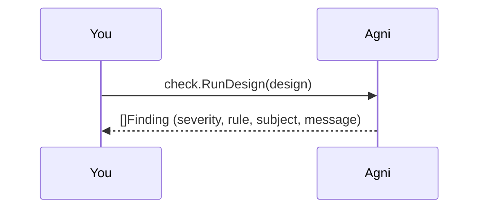

## Rules over the IR

agni's checks are rules evaluated over the neutral IR, not over source files, so they run the same on an EDIF netlist, a KiCad board, or an IPC-2581 export.

Each finding carries a severity (info, warning, error), the rule that fired, a subject (a net or a ref_des), and a message. This walkthrough runs the checks on a bundled design and reads them off.

## Pick a design {#pick}

> Give a path to any design (relative to this example folder), or your own file. The bundled designs live in ../common/designs: i2c-sensor/i2c-sensor.edn (built to trip one finding at each severity), two-resistors.edn (clean, no findings), demo-board.kicad_pcb, and demo-board.ipc2581.xml (each trips one rule). Three more exist for the sections below: dangling-wire.kicad_sch (wires drawn to empty space), driver-conflict.edn (pins that fight or float), and duplicate-refdes.kicad_sch (two symbols claiming one designator).

## Run the checks {#run}

> check.RunDesign applies the installed built-in rules and returns findings sorted by rule then subject. Nothing here reads a file, because checks are pure IR operations, so a KiCad board and an EDIF netlist go through the exact same rules (CONSTRAINTS C1).

## What is not flagged

Two nets in i2c-sensor look wrong but are not. SDA is an I2C net, but it has a pull-up resistor (R1), so the i2c-pull-up rule reports nothing. NC_SPARE has a single pin, but its name marks it as an intentional no-connect, so single-pin-net skips it.

No-connect awareness keeps the checks from drowning a real design in false positives (WS3-002). Engineers turn off a rule that fires on every deliberate stub.

## Wires drawn to nothing

Run the checks on dangling-wire.kicad_sch to see the dangling-endpoint rule. A .kicad_sch stores connectivity as geometry, so things connect only where their points coincide. A wire dropped a hair short of a pin looks connected but is not, and it never becomes a net, so no net-level rule can see it. The rule reports each such endpoint by its location.

The same fixture also shows what is not flagged. A wire is connected, not dangling, when it ends on a junction dot or a label, or meets a second wire. Only the ends that touch nothing are reported.

## Pins that fight or float

Run the checks on driver-conflict.edn to see the pin-direction rules. output-output-conflict flags a net where two driving pins fight each other, such as two outputs or two power sources. floating-input flags a net whose only pins are inputs, so nothing sets their level. Both read the pins' electrical direction, so they run on any reader that types its pins, EDIF here and KiCad schematics too.

These rules are deliberately conservative, so they avoid false findings on real designs. A bidirectional bus is not an output-output conflict, and an input with a pull resistor or a driver is not floating. The related power-input-not-driven rule flags a power pin with no source. It is KiCad-specific, since it needs the power-in / power-out distinction, and EDIF does not carry that.

## A check the reader catches, not the analysis

Run the checks on duplicate-refdes.kicad_sch to see duplicate-ref-des. It fires because two symbols are both labelled U1 (unit 1), and that is a genuine duplicate. Notice where this one is decided. The IR keys components by ref-des and folds a multi-unit part into one component with sections. So once the netlist exists, a duplicate is indistinguishable from a legitimate multi-gate part. Only the reader can tell them apart, while it parses. In KiCad a duplicate is the same unit claimed twice. The reader records the collision as an input diagnostic, and this rule just reports it. It is a "rule" in the catalog like any other, but the reader implements it, not the analysis engine (see docsite/content/architecture/ingestion-and-ir.md).

## A pull-up further out {#reach}

> pullup-reach.edn has two I2C lines. SDA_MAIN reaches its pull-up through four series resistors, and SCL_MAIN has two pull-ups, one direct and one behind a series resistor. At the default reach of 3, SDA_MAIN fails and the witness names the limit. pullup-reach.intent.yaml declares pull_up_reach_hops 4 for SDA_MAIN alone. With that line the designer says the bus's series network is sized for the deeper reach, and the same board then passes. SCL_MAIN keeps the default either way, and its pass lists both paths.

i2c-pull-up looks for a rail within three series resistors, because past three the series resistance is usually comparable to the pull-up and the bus no longer returns high in time. That is a default rather than a law. A design states a different reach for one net in its intent. check.WithIntent builds the model with that intent, and the model answers every pull-up walk from that net at the declared reach. The CLI form is agni check --verdicts --rule i2c-pull-up pullup-reach.edn --intent-path pullup-reach.intent.yaml.

## Same thing from the CLI

This walkthrough is the narrated form of one command:

    agni check i2c-sensor.edn

The next rung on the ladder diffs two revisions of a design.
