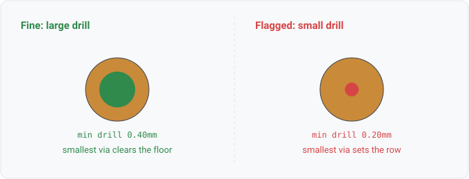

## board.via_drill

### What it is

`board.via_drill(net, mm)` yields one row per net that has vias, giving the net's MINIMUM via
drill diameter, held in metres and shown in mm. `net` is the net name (the join key to
`ir.Net.name`); `mm` is a number, so a query compares it with a unit (`?d < 0.3mm`). A net with several via sizes reports
only its smallest drill, not every via.

### For hardware engineers

On a net, the smallest drill is the most likely to fall below a fab's minimum drill capability or
to carry too little copper for the current through it. A review checks that number.
Query this to find nets with vias drilled under a house minimum, or to confirm a high-current net
does not route through an undersized via. The value is the physical drill diameter, so the
threshold you compare against is a real length, written with its unit.

### For software engineers

The routed net carries a set of vias, each with a drill diameter. `board.via_drill` is an aggregate
projection over that set, reducing it to the minimum drill keyed by net. The relation reports the
minimum, the safety-relevant extreme, rather than one row per via. That keeps it a compact per-net
answer rather than a full via dump. Rows are 1:1 with nets that have at least one via; a net with
tracks but no vias contributes no row. The stored unit is nanometres. The projector converts to
metres. The engine folds a query literal to the same SI base, and a cell is shown in millimetres.

### Go projector

`boardFacts` in `stdlib/relations/facts.go` walks `Model.BoardNets()` and, for each net, calls the
helper `minViaDrillNm(bn.Vias)`, which returns the smallest `Drill` across the net's vias. It
returns a false ok when the net has no vias, and then no row is emitted. The nanometre minimum is
converted with `nmToMM`, shown as millimetres, and emitted as `board.via_drill(net, mm)` with the
numeric value populated in metres for comparison.

The board tier is EMPTY on a netlist-only design. `Model.BoardNets()` returns nothing unless the
design was loaded with board geometry (`check.WithBoard`, fed a `.kicad_pcb` or IPC-2581 board
sidecar). For a query this is silent by construction, so `board.via_drill` yields zero rows on any
design without board geometry. The datasheet tier behaves the same way without `--params`. An
empty answer does not mean every via is large. It can mean the design carries no board at all.

### Datalog

Every net and its minimum via drill:

```
board.via_drill(?n, ?d) => ?n, ?d
```

Nets with a via drilled below 0.3 mm:

```
board.via_drill(?n, ?d), ?d < 0.3mm => ?n, ?d
```

Write the threshold with its unit. A drill is held in metres and shown in millimetres, so a bare
`0.3` would mean 0.3 m and every net would answer.

Both need a board-bearing design (a `.kicad_pcb` or an IPC-2581 file); on a netlist-only load they
return nothing.

### Schematic


