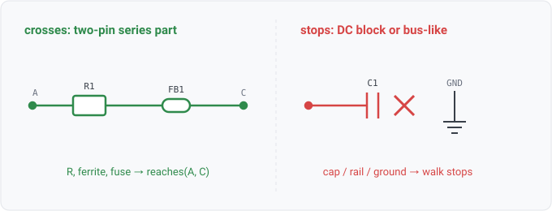

## net.reaches

### What it is

`net.reaches(from, net)` is true when `net` is reachable from `from` by walking THROUGH series pass
elements: resistors, inductors, ferrite beads, and fuses. It is a transitive-closure predicate.
The protection rules use it to answer "is there a component of class X somewhere on the path
between these two nets?" without hard-coding a topology.

`net.reaches(from, net, hops)` is the same walk with the distance exposed, so a rule states the
radius its own question needs. `hops` is an exact count, not a budget, and the next section explains
why that matters before you use it.

Unlike the fact relations, `net.reaches` is computed on demand from the design graph rather than
stored, so it is a datalog *predicate* (kind `predicate` in the catalog). It is the recursive
counterpart to `net.bus_like`. `net.bus_like` names the nets the walk refuses to enter, and
`net.reaches` is the walk itself.

### Distance, and the trap in it

`hops` binds the ACTUAL number of series crossings, reflexive at 0 (a net reaches itself). Because a
datalog argument binds by equality, putting a bare number in that slot means *exactly* that distance:

```
net.reaches(?n, ?rn, 2)           # exactly 2 crossings, so it SKIPS a part sitting 1 away
net.reaches(?n, ?rn, ?h), ?h <= 2 # within 2 crossings, which is what a protection question means
```

The first line reads like a radius and is almost never what a query means. Use the
comparison form for a radius.

The engine deliberately holds more than one radius, so the radius belongs in the rule. The
query built-in searches the whole neighborhood (`topologyReachHops`), because a topology question
like "what is connected to what through passives" wants distant answers. The protection guards ask at
`check.ProtectionReachHops` (2), and the power-entry walk at `check.PowerPathReachHops` (3), because
"is a clamp electrically adjacent to this pin" wants only near ones. A discharge pushes through every
series element before the clamp conducts, so a TVS six resistors away protects what is downstream of
itself, not the pin. Suppose a protection predicate were composed out of the wide default. It would
credit that distant TVS and report a genuinely unprotected pin as clean. That outcome is a false
pass rather than a missing result.

### For hardware engineers

The walk crosses a two-terminal series part. A resistor, bead, or fuse joins exactly two nets, so
crossing one follows the signal one hop along its path. The walk stops at anything that is not a
point-to-point series node. A capacitor stops it, since a DC block does not pass the signal on. A
ground plane, a global rail or any rail-scale fan-out stops it, since a distribution node is not a
path. A part with more than two nets stops it too, since a transceiver or connector is not a series
element. With this walk, an ESD or input-protection review can ask "does a clamp sit anywhere
between this connector pin and the device pin?", and a resistor or bead in the middle of the path
does not break the question.

### For software engineers

`net.reaches` is transitive reachability over a filtered graph whose nodes are nets. An edge
exists only through a two-net pass element. `net.bus_like` nets are excluded, so the traversal
cannot leak into a global singleton and mark the whole design reachable. It is a bounded BFS, so a
query over it terminates. A hop cap guards pathological depth, and fan-out and finiteness bound the
walk anyway.

### Go projector

`net.reaches` has no `stdlib/relations/facts.go` projector because it is not a stored fact. The query
engine evaluates it as a built-in in `core/query/preds.go` (bounded by `topologyReachHops`),
delegating to `check.Model.Reach` in `core/check/reach.go`. It uses the same `IsBusLike` stop
predicate that `net.bus_like` exposes. The protection rules run the same walk at a smaller radius
(see Distance above). The third argument binds `Reach.Depth`. The BFS records that depth as it goes
rather than re-deriving it from the `Parent` chain, because the chain can disagree where parallel
passes bridge the same two nets. `net.reaches` is computed, not projected, so it is outside the
per-relation EDB doc requirement. This page documents it as the reference behind the walk.

### Datalog

Every net reachable from a starting net, through series parts:

```
net.reaches("VBUS_IN", ?net) => ?net
```

The components that sit on those reachable nets (what a protection walk would find):

```
net.reaches("VBUS_IN", ?net), component.net(?r, ?net) => ?r
```

The same question at a protection radius, the way a rule scoped like `esd-protection` asks it,
over a TVS within two series crossings of the net:

```
net.reaches(?n, ?rn, ?h), ?h <= 2, component.net(?t, ?rn), component.class(?t, "tvs") => ?n, ?t
```

When a radius is not behaving as expected, ask how far away each reachable net is:

```
net.reaches("VBUS_IN", ?net, ?hops) => ?net, ?hops
```

### Schematic



### Where this is going

A path question has no way to state itself, so each caller hand-codes a walk. The hop-radius trap
above, the per-caller radius constants, and the baked-in edge class are all symptoms of that.
Issue 374 designs a topology-pattern surface where the radius is a quantifier, the edge class is a
character class, and a match carries the path it found. If that ships, `net.reaches` becomes one
canned pattern and this page becomes the migration note.
