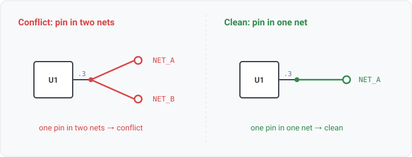

## reader.pin_net_conflict

### What it is

Sometimes a read puts a single `(ref_des, pin)` on more than one net. Then
`reader.pin_net_conflict(ref_des, pin, net)` yields one row per net the pin was placed on. Because a
pin belongs to exactly one net by definition (a net is the equivalence class of joined pins), any
pin that appears in two nets is malformed input, a reader bug or a corrupt export, not a design a
person drew. There is one row per claiming net, so a query can name every net that the conflicted
pin touches and join to those nets.

The `pin-net-conflict` integrity rule fires a finding on the same condition. This relation is the
rule's query-relation face, and it lets you interrogate the condition ad hoc.

### For hardware engineers

You should almost never see this. A pin is one physical node; it cannot legitimately be part of
two separate nets at once. When it shows up, the tool's *read* of the file disagreed with itself.
Its first corpus runs surfaced two reader gaps (unannotated placeholder refs merged, WS1-024;
duplicate port designators collapsed, WS1-025). Treat a row as "fix the read," not "fix the
board."

### For software engineers

A net is an **equivalence class** over pins, so membership should be a function mapping each pin to
one net. This relation reports the keys where that function became one-to-many. Every per-pin answer
downstream relies on that invariant, and `pin.net`, diff keys and viewer highlights all do. Rows are
1:many with the offending pin (one per claiming net); an empty result means the read is clean and
every pin resolved to a single net.

### Go projector

`pinNetConflictFacts` in `stdlib/relations/facts.go` iterates `Model.PinNetConflicts()` and, for each
conflicted pin, emits one row per net in its `Nets` list. Empty when the read is clean. A pin of a
collided ref-des is *not* reported here, since that root cause belongs to the `duplicate-ref-des`
finding, so one authoring slip yields one finding, not two.

### Datalog

Every conflicted pin and the nets claiming it:

```
reader.pin_net_conflict(?r, ?p, ?n) => ?r
```

Join to the components on each claiming net (what else the malformed read tangled together):

```
reader.pin_net_conflict(?r, ?p, ?n), component.net(?other, ?n) => ?other
```

### Schematic


