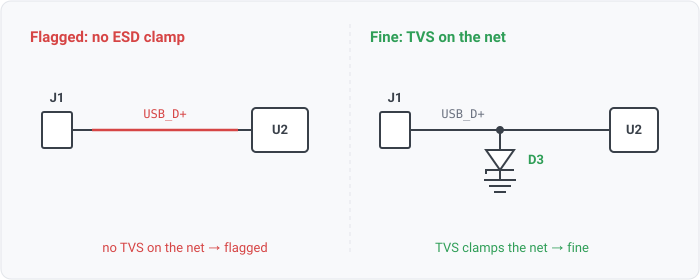
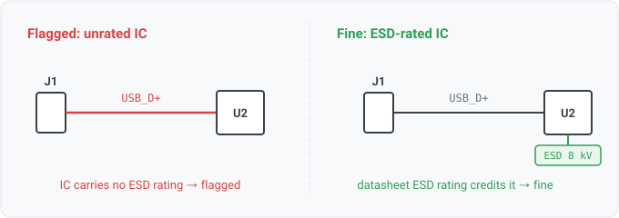

## esd-protection

### What it means

When a connector exposes a signal net to the outside world, the net should
carry a TVS (ESD clamp) device.

### Why engineers want it

ESD protection on external interfaces is a standard review and
compliance item (IEC 61000-4-2 exists because fingers do). The clamp must be a deliberate
component on the net; internal chip protection is designed for handling, not for system-level
strikes.

### Impact

Field failures that never reproduce in the lab: flaky USB ports, dead data lines
after winter, latent damage that surfaces weeks later.

### Scope note

A signal counts as protected in two ways. A discrete TVS can clamp it (within a 2-hop series reach),
OR an IC on the net can carry a datasheet ESD rating at or above the credit floor. The second is
IC-integrated ESD (WS3-073), the common industrial posture. The IC path needs a seeded PartSpec
(`--params`), so on a design read with no datasheets it credits nothing. A net whose only protection
in reach is a Zener clamp is reported by `esd-clamp-not-tvs` and gets a not-considered verdict here.
The IC path credits ONLY a SYSTEM-level rating (IEC 61000-4-2), NOT a handling model (HBM/CDM), and
it reads the rating's test model from a declared `esd_test_model` attribute (WS3-077), so an
unstated or handling rating never credits. Crediting an HBM handling rating on a harness input would
hide a real ESD gap, since handling ratings are for assembly, not field strikes. A follow-up would
match the rating to the connector-facing PIN rather than the whole part. It was deferred with
WS3-077, since the PartSpec carries no structured pin applicability, and the findings it would
change are largely correct anyway.

The rule approximates "external" as a net with a connector-class member and none of the
following: a power pin within the power-path reach, a cross-sheet continuation, an intentional
no-connect, rail facts (global / power_driven), a ground name, or a power-rail NAME
(VCC/VDD/VBUS/12V-style). Rails have their own rules (input-protection, bulk-cap), and the name
check is the only rail evidence a directionless netlist (EDIF) carries. A DEBUG / TEST / edge-card /
programming connector is excluded because it classifies as `test_connector` (WS3-066), a distinct
class from `connector`. So the rule does not treat a bench interface (a JTAG header, a SAMTEC edge
card) as harness exposure. The debug-connector patterns are lexicon defaults, and a project can
extend them. A design can declare a board-to-board, module, mezzanine or card-slot connector
`internal` in its intent (`components: {J1: {exposure: internal}}`), and the rule excludes it too.
Such a connector joins this board to another one inside the product, and nothing a user touches
reaches it. That is a declaration rather than a class, since the same connector is the module
socket on one carrier and the cable entry on another (agni issue 831).
Severity is info because the approximation still cannot know whether a plain header is a real
external interface or an unlabeled internal one. Since WS3-011
the clamp may sit one series hop away (connector -> series R -> clamped node, the classic ESD
topology), so the TVS existence check runs over the net's 2-hop reach. True ordering ("the clamp is
connector-side of the IC") remains unmodeled; reach makes the existence check topology-tolerant, not
directional.

### Query structure

select external signal nets, require a TVS member.

    select N in nets where exists C in N.connections where class(C) == connector
      and not exists P in N.connections where pin_dir(P) in {power_in, power_out}
      and not ground_name(N) and not rail_name(N) and not global(N) and not intentional_nc(N)
      and not exists G in N.connections where class(G) == tvs

Reads: component.class, net.attributes, net.names (the ground/rail-name skips), on_net,
pin.electrical_type, pin.no_connect (the no-connect skip). Tier R.
