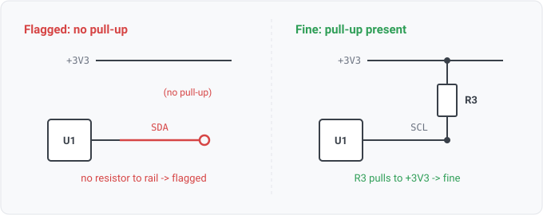

## i2c-pull-up

### What it means

Every I2C net (its two lines are SDA and SCL) must have a pull-up resistor
to its rail. Open-drain pins can only pull low; the pull-up returns the line high.

### Why engineers want it

Open-drain is a shared-bus trick: many parts can pull the line low,
and a single pull-up returns it high. The pull-up is external and easy to forget, especially
when every chip on the bus has a weak internal pull-up and a designer wrongly assumes it is
enough. TI and others publish app notes on it, and it recurs as a field failure.

### Impact

A missing pull-up means the bus is stuck low and no device on it communicates.

### Scope note

This is the presence check, which needs no datasheet. The pull-up value being in range is a
datasheet-joined rule (a separate, Tier-X check). The shared component.class fact decides which
parts are resistors. It applies the ref-des prefix convention (R, RN) and refines it with
part-type data when the source carries any.

**The check follows the resistor's OTHER end.** It is not enough for a resistor to touch the bus,
because a series termination or bus-isolation resistor does that and holds nothing high. The rule
walks from the bus across resistors, never through ground, and passes only when it arrives at a
rail. Until issue 375 it asked the membership question instead, so a bus with a series resistor and
no pull-up at all passed at error severity.

The walk is bounded at `check.PullUpReachHops` crossings by default. One is a pull-up sitting
directly on the bus. Two is a bus segment separated from its pull-up by a series resistor. That
topology is ordinary, and a one-hop test would report a false positive on it. Past three the
accumulated series resistance is comparable to the pull-up, so the node no longer returns high in
the time the bus needs and there is nothing worth crediting.

Some designs reach a pull-up through a deeper series network, sized so the bus still returns high.
Such a design declares the reach for that net in its intent (`nets: {SDA_MAIN: {pull_up_reach_hops:
4}}`, agni issue 820). The walk then searches that far for that net alone, and a failing verdict
states the limit in effect, so "within 4 hops" says the bus was held to its declaration rather than
to the default.

A passing verdict lists every distinct pull-up within the limit, one path per terminating resistor,
ordered by hop count, then resistor, then rail (agni issue 821). With more than one, the statement
names each and every path is a `path` term (`SCL -> [R6] -> ISO_B -> [R7] -> VCC_3V3`), so a bus
with a direct pull-up and a second behind a series resistor shows both. A bus with one pull-up
carries the same statement and context it always did.

A resistor marked do-not-populate is not crossed, because an unfitted part pulls nothing (agni issue
938). A line whose only pull-up footprint is DNP fails. That failure is right when the design relies
on pull-ups the netlist does not show (inside a level translator, on a plugged-in module), and the
reliance is worth recording.

Sometimes the schematic marks a bus pin no-connect and the pin is alone on its net. The rule does
not consider that pin (agni issue 1244). A part's SMBus or I2C pins are often unused, and KiCad
names the stub after the pin (`unconnected-(U15-SDA/SMBDAT-Pad37)`), so the name reads as a bus
while the designer has said nothing is attached. A flagged pin that is also wired to another part is
still judged.

The walk crosses resistors only and never crosses ground, because a resistor to ground is a
pull-DOWN. Counting it would pass a bus with no pull-up, and this rule exists to catch that bus.

Some parts pull the line up themselves, and a level translator's ports are the common case (agni
issue 1298). The rule credits such a part when its datasheet binds an internal pull-up to the part's
pin on the net. The row has to be bound to that pin, since a part-wide statement would credit pins
it does not cover, and the pass names the part, the resistance and the row. A failure does not name
a part it could not read, because almost every bus has a microcontroller with no datasheet in the
run, and its weak internal pull-up is not the pull-up a bus needs.

The lexicon's `i2c` vocabulary decides which nets are I2C, and a project extends or replaces it in
its conventions (agni issue 1265). The built-in match is at a **token boundary**, not a substring
(WS3-037): `SDA`, `SCL`, `I2C_SCL`, and `SCL0` match; `SPI_SCLK` (an SPI clock), `SCLK`, and `MCLK`
do NOT, because `SCL` abutting another letter is a different signal. A name carrying an `I2S` token
is excluded, since an I2S data line is often named after its `SDA` pin (agni issue 1255). The
remaining WS3-037 work generalizes this presence check to an arbitrary profile-declared signal set
(CS, reset, boot straps).

### Query structure

select the I2C nets whose resistor walk reaches no rail.

    select N in nets where is_i2c(N) and not pullup_reaches_rail(N)

Reads: net name (pattern), on_net, component.class (resistor). Tier R.