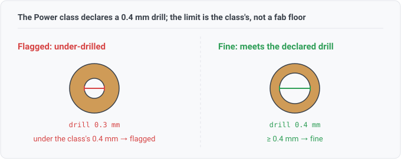

## netclass-via-drill

A net's via is drilled smaller than the drill its own net class declares.

## What this checks

For each net class, the project's `net_settings` states the via drill that class's nets should use.
This compares each net's smallest routed via drill against that declared drill and reports the nets
that fall short.

There is no number in this rule. The limit comes entirely from the design.

## How it differs from `hole-size`

`hole-size` asks **can this be drilled**, comparing via drills against a universal mechanical-drill
floor (0.2mm). A finding there means the fab cannot make the hole, or will silently upsize it.

This rule asks **is this what you asked for**. A class's declared drill is usually sized for the
class's current, or for the process quoted for the board. A via below it is often
perfectly drillable, and still discards the reason the number was chosen.

## Resolving the declared drill

A net can belong to several classes at once, and a naive implementation goes wrong here.

KiCad does not pick one of a net's classes and use it wholesale. It fills each constraint from the
highest-priority class that states **that** constraint, and the `Default` class supplies whatever is
left over. `Default` applies to every net, including nets in no class at all. Suppose a net's
high-priority class declares only a track width. The net still takes its via drill from the next
class down, and a net in no class still has a drill to meet.

A rule could compare a net's vias against every class the net belongs to. That would fail nets that
correctly obey the winning class. This rule resolves the cascade first, then compares once, and the
finding names the class that supplied the limit.

Sometimes none of a net's classes, `Default` included, states a drill. That net has no limit to
meet, and the rule reports that rather than a pass.

## Hardware context (for software readers)

- A **via** is a plated hole connecting copper on different layers. The **drill** is the hole
  diameter before plating.
- The declared drill matters because a bigger drill carries more current and plates more reliably.
  A class that declares one has usually been sized with both in mind.

## Absence is not a pass

The rule declares `CapNetClassDefs`. A design that declares no net-class definitions has no limit to
compare against, so the rule reports not-applicable rather than running over zero comparisons and
reading clean. Only a KiCad project read supplies definitions.

The rule reports a net with no vias as not-considered, since there is nothing to measure.
