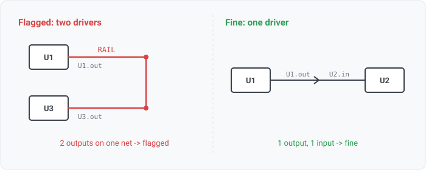

## output-output-conflict

### What it means

A net with two or more pins that actively drive it, whether signal outputs or power
sources. A net may have at most one hard driver; two of them fight.

### Why engineers want it

It is one of the ERC pin-type-matrix's flagship errors (output ↔ output).
It happens when two blocks are wired to the same node by mistake, a bus is drawn without tri-state
enables, or two regulators drive one rail. The symptom is contention current, with the net
sitting between levels while both drivers source into each other.

### Impact

Contention burns power and can destroy the output stages; the logic level is undefined.

### Scope note

Counts hard drivers only, meaning outputs and power-outputs. Bidirectional (INOUT) pins are not
counted, because a shared bus of bidirectional pins is legal. Flagging it would be a false positive,
and false positives make engineers mute the rule. Pin roles come from the reader's electrical types,
so when a design's reader does not type pins, the rule does not fire. This is a row of the
connection matrix (rule_pin_matrix.go); the pairing subsumes output ↔ output, output ↔ power-out,
and power-out ↔ power-out.

### Drivers are counted per COMPONENT, not per pin

A power device commonly drives one net through several paralleled output pins, and electrically
that is one driver. One driver IC in the real corpus has six output pads on one net. Two-plus
driving pins of the SAME component never fire; two different components' outputs do. This surfaced
the moment EDIF pin keys joined physically (WS1-025). The count lives behind the
driving_components FFI, since a distinct-count is not (yet) an AST shape.

### A wired-OR bus is not contention

On an open-drain bus, such as a shared interrupt, inhibit, or reset line, several devices have
outputs that only pull to one level, and a pull resistor sets the idle level. That is intentional,
not two drivers fighting. EDIF types open-drain pins plain "output", so the rule reads the PULL
RESISTOR instead. When a multi-driver net carries a resistor and NO power-source (POWER_OUT) driver,
the rule treats it as a wired-OR bus and reports nothing. The resistor is matched by PRESENCE, not
by where it pulls to, because a real pull runs through several elements to an auto-named rail or to
ground. The power-source exclusion matters because two power sources on a rail fight even with a
bleeder resistor present, so a POWER_OUT driver keeps the rule firing.

### Query structure

select the nets driven by two or more distinct components, excluding wired-OR buses.

    select N in nets where count(distinct component(P) : P in N, hard_driver(P)) >= 2
      and not (has_resistor(N) and not any(power_out(P) : P in N))

Reads: on_net (the net's members), pin.electrical_type, component.class (the resistor pull). Tier R.