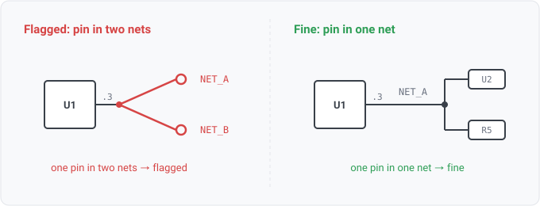

## pin-net-conflict

### What it means

One (component, pin) appears in the connection lists of two or more
nets. A net is the equivalence class of electrically joined pins, so membership is
many-pins-to-one-net by definition; multiple membership is malformed input from a reader bug or a
corrupt export rather than a design error a person drew.

### Why engineers want it

They should rarely see it. It is an integrity tripwire. The engine answers per-pin net
questions for pin.role consumers, diff keys and viewer highlights, and this rule sits behind
every one of them. When the invariant breaks, the rule fires, instead of every downstream
answer silently becoming arbitrary. PinNetName documents that it reports the first net in
design order, and this rule makes that arbitrary pick safe. A firing points at the READ,
not the design. The rule's first corpus run surfaced two reader gaps (unannotated placeholder
refs merged, WS1-024; duplicate port designators collapsed, WS1-025).

### Impact

Without the tripwire, an inconsistent netlist degrades every derived answer
quietly. With it, the file is flagged at check time with the claiming nets named.

### Severity is info, deliberately

Both known producers of this state were reader gaps
(WS1-024, WS1-025), and both are fixed. The KiCad board reader now skips placeholder footprints,
and the EDIF reader resolves port instances. A firing still points at the tool's read of the file
rather than at the design, and flagging it louder would blame the engineer for our keying.
Raising it is a job for severity configuration (WS3-006).

### Two deliberate suppressions

A duplicated ref-des produces this state mechanically, since
each colliding placement brings its own copper, so their shared (ref, pin) key ends up in
several nets. That root cause is duplicate-ref-des's finding; pins of collided ref-des
are skipped here so one authoring slip yields one finding, not two. (The
sheetnav conformance fixture showed this the first time the rule ran.)

The second is an UNANNOTATED ref-des: `R?`, `C?`, `REF**`, or a partly-assigned
`C?1845`. This rule asserts something about a PIN, and `(R?, 1)` does not name one. On one
export, 176 distinct un-annotated resistors shared that key. So the index saw a single pin
sitting on 129 nets, and 77% of this rule's findings on that design described a netlist that
was fine. The design is not malformed, because a placeholder is not a key. The un-annotated
parts are reported by `unannotated-components` instead, so nothing is hidden.

### Query structure

report each conflict the model collected.

    select P in pin_net_conflicts
      where not ref_des_collided(P) and not ref_des_unannotated(P)

Reads: pin.on_net, reader.ref_des_collision (the suppressions). Tier P.