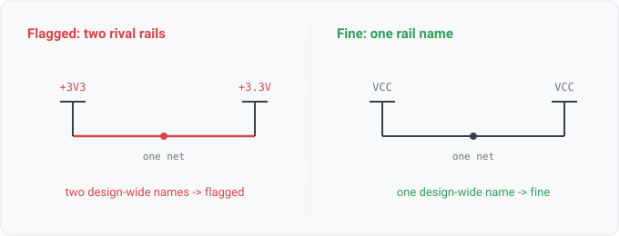

## power-tap-conflict

### What it means

One net's collapsed alias list holds two or more distinct DESIGN-WIDE
names, meaning power-symbol rails or global labels (rank 0 in the name-scoping model of
`architecture/net-solving.md`).

### Why engineers want it

Design-wide names unify by name across every sheet. If two of them
sit on one net, every tap of EITHER name anywhere in the design connects to this net, so a
wire joining a +3V3 symbol to a +3.3V symbol merges two design-wide rails rather than aliasing
two spellings. That is either a real short drawn with symbols or a naming split
that scatters one rail's story across two names.

### Impact

Merged rails are a power-integrity defect, as when a mislabeled tap joins a 5V
and a 3V3 net. Split naming corrupts rail-level review and any per-rail analysis.

### Scope note

Only design-wide names count, so a rail's local nickname (a sheet label on the VCC net) is normal
aliasing and does not flag. Net classes are NOT covered here. A KiCad net may belong to several
classes, and `netclass-track-width` and `netclass-via-drill` check the constraints declared by those
classes. Some readers emit every label at rank 0 (xschem, gEDA inline names). Their formats get the
strict interpretation, where any two names on one net are rivals.

### Query structure

select nets carrying two or more distinct rank-0 names.

    select N in nets where count(distinct name : name in aliases(N), design_wide(name)) >= 2

Reads: net.attributes. Tier R.