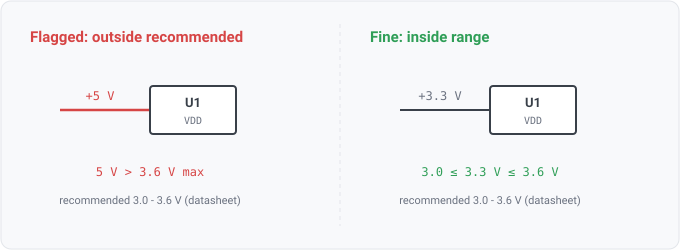

## rail-nominal-out-of-recommended

### What it means

A component is joined to a seeded datasheet spec by MPN. One of its power-input pins is on a rail,
and the rail's name states a nominal voltage outside the spec's recommended operating supply range
(VIN/VDD/VCC-family symbol, limit kind RECOMMENDED_OPERATING, min..max). This rule is the
recommended-operating sibling of `supply-exceeds-abs-max`, with the same datasheet join applied to the
vendor's functional envelope rather than the damage ceiling.

### Why engineers want it

The absolute-maximum rating says where the part is damaged; the recommended operating range
says where its datasheet specifications are guaranteed. A rail between the two still runs the
part, but outside the vendor's characterized conditions, where margin, accuracy, timing, and lifetime
are no longer assured. As with its sibling, the range is the vendor's own number. The finding
carries its provenance (document revision, page, table, extraction method, confidence), so a
reviewer verifies the citation rather than trusting the tool.

### For software readers

A rail is a global constant, and every consumer reads it. The recommended range is the part's
declared precondition on that constant. `supply-exceeds-abs-max` is the hard assertion that crashes
the process (exceed it and the part may be destroyed); this rule is the softer contract check that
the input is inside the documented, supported range, where behavior is defined. A rail outside it
is like an API call with an argument outside its documented domain. The call may return something,
but nothing about the result is promised.

### What it skips rather than guesses

Every input that cannot be trusted is a skip, never a guess:
- no seeded set at all -> not-applicable (`check.Available` reports that it needs `--params`);
- no MPN or unseeded MPN -> silent;
- a part whose spec binds limit rows to pins -> left to `pin-out-of-recommended`;
- limit rows that are under-specified or carry text-only conditions are not compared
  (param.MachineComparable, the comparison semantics in `architecture/datasheet-layer.md`);
- a row printed in a prefixed unit (mV, kV) is reduced to volts by the parameter layer's one
  conversion table, and BOTH bounds of the range are reduced together; a unit missing from that
  table is skipped rather than scaled by a guess;
- a rail name with no parseable nominal, or with conflicting nominals, is not compared;
- a part that declares MORE THAN ONE recommended supply range is skipped entirely. A netlist does
  not label which power-in pin is which supply, and the range is two-sided, so matching an unlabeled
  pin to a range risks a false finding (`pin-out-of-recommended` checks such a part per pin when its
  spec binds pins). Its one-sided sibling has no such restriction, because a ceiling is conservative
  to apply across every power-in pin.

### Query structure

join components to specs by MPN; act only on a part with a single machine-comparable
recommended supply row; for each power_in pin, parse the attached rail's nominal from its net
name and flag it when it is above the row's max or below its min.

    select C in components where spec(C) != nil and not pin_bound(spec(C))
      let R = recommended_operating(spec(C)) where |R| == 1
        for P in pins(C) where electrical_type(P) == power_in
          nominal(net(P)) > max(R) or nominal(net(P)) < min(R) -> finding

Reads: param.recommended_operating, pin.electrical_type, net.name, on_net. Tier R.
