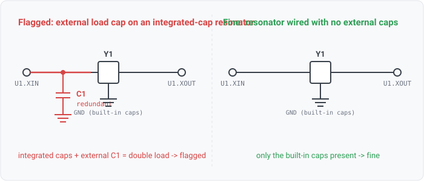

## resonator-redundant-load-caps

### What it means

A ceramic resonator of the built-in-cap family (Murata CERALOCK and kin, ref-des `Y`) already
contains its load capacitors, so its oscillator terminals connect straight to the driver and
its center pin to ground. No external load caps are needed. This rule flags a resonator
terminal that carries an external load capacitor to ground, the "double load" mistake.

### Why engineers want it

The load a crystal or resonator sees sets whether it starts and at what frequency. A ceramic
resonator with integrated caps is specified for that load already built in. Add external load
caps to ground and the total load roughly doubles, well above spec, so the oscillator starts
slowly, starts only over part of the temperature range, or runs off-frequency. Everything
clocked from it drifts with it. The mistake usually comes from reusing a crystal footprint for
an integrated-cap resonator. A crystal does need the caps. The circuit usually oscillates on the
bench and fails in the field.

### Impact

An over-loaded resonator starts slowly, fails to start over temperature, or runs off-frequency. The
resulting timing failures pass bench bring-up and appear in the field.

### Scope note

The rule quantifies over ceramic-resonator COMPONENTS. The classifier cannot tell a resonator from
a crystal by tokens, so the `ceramic_resonator` class is datasheet-seeded (WS10-015). An
un-subtyped clock candidate is NOT treated as a resonator, and this rule is silent on it. A crystal
genuinely needs its caps, and crystal-load-caps checks them. A capacitor is counted as an external
LOAD cap only when it sits on a resonator terminal net AND also reaches ground. A coupling or
series cap between two signals does not touch ground, so it is not a load cap and is not flagged.
Ground-named nets are the resonator's center/case pin, not signal terminals. An unresolved external
net is reported not-considered, because its wiring may live on an unread sheet. That matches the
crystal-load-caps external-skip convention. This rule checks the PRESENCE of a redundant cap, not
its value. The exact integrated-cap value is a datasheet-joined refinement (WS10), out of scope
here.

### For software readers

This is the mirror of crystal-load-caps. A crystal is a component with a required companion
dependency, its load caps, which must be present. A built-in-cap resonator is a variant that
satisfies that dependency internally. Wiring the companion parts again overrides a default, which
is redundant and harmful. The check is "this node has a dependency it should NOT have," the
negative of "this node is missing a dependency it must have." We detect the resonator variant from
its declared class (datasheet-seeded), not from a name. The active-XO skip in crystal-load-caps
also detects a variant, though structurally.

### Query structure

select ceramic resonators; for each non-ground, resolved terminal net, fire if a capacitor on
that net also reaches ground.

    ground_refs = { component | some pin on a ground net }
    for Y in components where class(Y) == ceramic_resonator:
      for N in nets(Y) where not ground(N) and not external(N):
        if exists C in N.connections where class(C) == capacitor and C in ground_refs:
          FIRE(Y, N, C)

Reads: component.class, net.attributes (external), net.names (the ground skip and cap-to-ground
test), on_net. Tier R.
