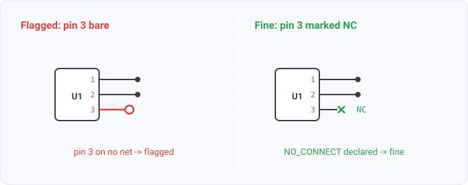

## unconnected-pin

### What it means

A placed component's part type declares a pin, and that pin appears in no
net's connections and is not marked NO_CONNECT.

### Why engineers want it

unconnected-component catches the part wired to nothing; this
catches the pin wired to nothing on a part that is otherwise connected, the far more common
slip. Every ERC ships it.

### Impact

Picture a floating enable, a missed feedback divider, or one gate input of four left open. Each
leaves a part that mostly works and fails in ways that read as a component defect.

### Where it can and cannot fire (conservative on purpose)

Three guards, each learned
from a real source:
- **The source must have a no-connect channel** (any NO_CONNECT-typed pin, no-connect-flagged
  net, or designer's NC_ / no_connect net name anywhere in the design). Where none exists, an
  unwired pin carries no NC flag because the format cannot express one, not because the designer
  missed it. A bare EDIF netlist export lists every library pin of every part. Firing there
  produced 1836 findings on one real board (unused gates, spare TVS channels, unwired connector
  pads, all normal). Without a channel the rule reports not-applicable.
- **A direction-unknown (UNSPECIFIED) pin is skipped**, the same trade floating-input makes.
- **A source with no part-pin data yields no pins** and is silent by construction.

On KiCad, placed bare pins go onto synthesized per-pin stub nets (the miss surfaces as
single-pin-net instead). The rule can still fire there on a typed pin of an unplaced unit of a
multi-unit part, in designs that use no-connect markers elsewhere. That is a real unused-unit
signal. The rule finds most on sources with typed pins, an NC vocabulary, and no stub
synthesis (EDIF schematic exports, xschem/gEDA with symbol libraries).

### Query structure

gate on the channel, then select the pins on no net, excluding
declared no-connects and direction-unknown pins.

    select P in pins where nc_channel(design)
      and pin_dir(P) not in {no_connect, unspecified} and not on_net(P)

Reads: pin.electrical_type, pin.on_net. Tier R.