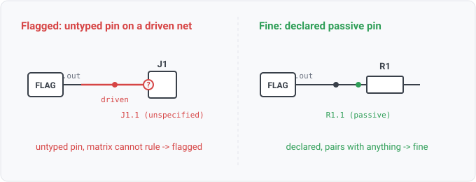

## unspecified-pin-with-driver

### What it means

A net has at least one hard driver (output / power-out pin, including a
power symbol's virtual pin), and one of its other member pins declares no electrical type at
all.

### Why engineers want it

It is the "unspecified" column of the ERC connection matrix (KiCad
warns on unspecified against everything). An untyped pin is a library gap, since the matrix cannot
say whether the pairing is legal. The gap matters most on a driven net, where the untyped pin
might itself be a fighting driver or a supply pin shorted to a signal.

### Impact

If the untyped pin turns out to be an output, this is an output-output-conflict that the matrix
could not see. If it is a supply pin, this is a rail-to-signal short. Fixing the symbol (typing the
pin) either clears the warning or upgrades it to the real error.

### Scope note

"Unspecified" means the symbol DECLARES the pin and types it as nothing. A
KiCad passive pin is typed and never fires this. That false positive, a resistor on every driven
net, kept this row out of the catalog until PASSIVE entered the direction vocabulary. Sometimes
the read never saw a symbol for a pin (a board footprint's pads, a sub-sheet component in a
root-only hierarchy read). That is a read gap, not an authoring gap, and the rule skips the pin via
pin.declared. The rule is gated on a driver being present. A wholly untyped read (a bare EDIF
netlist with no direction data) has no drivers in evidence, so the rule reports nothing on it by
construction. Cross-sheet (external) nets are skipped. Virtual power-symbol pins carry
power types by construction and are excluded as subjects.

### Query structure

select the driven nets carrying a declared-but-untyped real pin.

    select N in nets where count(distinct component(P) : P in N, hard_driver(P)) >= 1
      and exists P in N.connections
        where pin_dir(P) == unspecified and declared(P) and not virtual(P)

Reads: net.attributes, on_net, pin.electrical_type. Tier R.