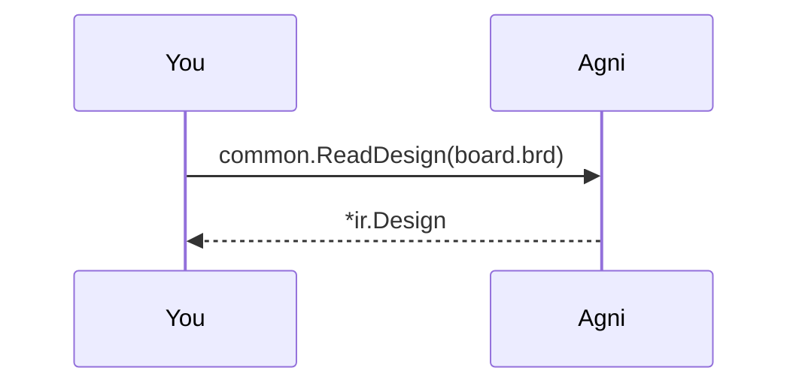

## An Allegro board, read as it is saved

Allegro boards usually reach other tools as an ODB++ or IPC-2581 export, and someone with an Allegro licence has to make it. Agni reads the `.brd` itself, so you can check a board you were only sent.

Only boards saved by Allegro 17.2 are read so far. A board from another release is refused with the release named.

## Pick a board {#pick}

> The default is the BeagleBone AI, a public board from BeagleBoard.org (CC-BY-4.0) that `make samples-oracle` fetches into tools/samples/. No synthetic Allegro board can be made without Allegro, so this is the one example that reads a real board. Give the path to your own .brd to read that instead.

## Read the netlist {#netlist}

> The reader builds the netlist from each net's chain of placed pads. Each part carries its footprint, its value and its device type. Pin names are not read yet.

## Read the board {#board}

> The same file also gives the board geometry. The copper layers are renamed F.Cu, In1.Cu and so on down to B.Cu, as every board format is, so the renderer and the copper rules read it as they read a KiCad board. A part on the bottom is mirrored.

## Run the checks {#check}

> With the board in the model, the copper rules run as well. On the BeagleBone AI most findings are track-width. The board routes 4 mil traces, and the rule judges them against its fixed 5 mil floor, because the board's own constraint sets are not read yet.
