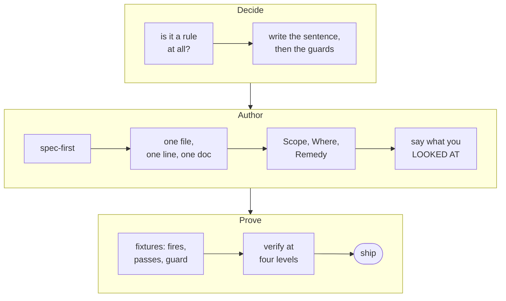
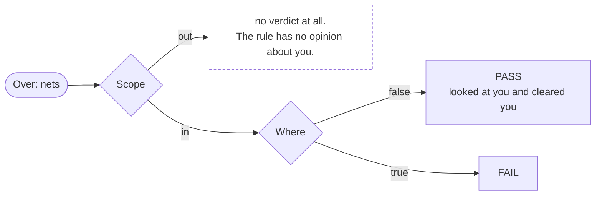
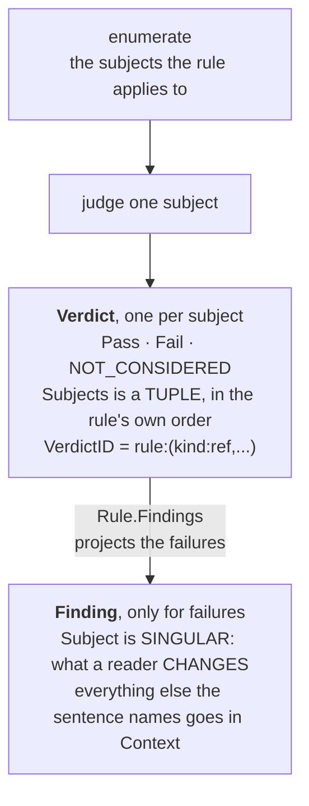
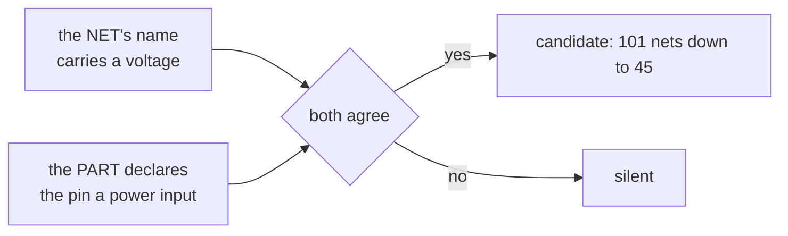

A check rule asserts something about the design as it was read: "every rail carries a test point". It
does not compute the way analysis does, it does not fix anything, and it has to be checkable from the
IR the readers produce today. The architecture behind the pieces lives in
[Rules and checks](../../architecture/rules-and-checks/) and
[Net solving and hierarchy](../../architecture/net-solving/). This page is the practical path, worked
through one real rule, `test-point-coverage`.

## Is it a rule at all?

Ask what the rule reads. If the answer includes data no reader emits yet (net classes, datasheet limits
before the parameters tier exists), the reader work comes first and the rule waits.

The worked example comes from a design-for-test checklist: rails and {{ explainable "ground" }}
should be probe-able. It reads component classes, net membership, and rail-ness, all three present in
the IR. So it is a rule.

## Write the sentence, then the guards

A rule is one sentence plus its exceptions. The exceptions keep an engineer from muting it. Write the
sentence first:

    A power rail or ground net must carry a test-point component.

Then interrogate it the way a real corpus will.

| The question | What it settled here |
|---|---|
| What if the board has no test points at all? | A demo board is not wrong, it just has no test-point convention. Fire only where the design places test points somewhere. This kind of channel gate once took a rule from 1836 findings to zero. |
| What is "a rail" when the format carries no direction data? | A bare EDIF netlist has no rail evidence except the name, so fall back to rail facts or rail/ground name heuristics. |
| What about nets the read did not fully cover? | Skip nets marked external. |
| Who decides the policy edge cases, like a feedback node named like a rail and deliberately left unprobed? | The reviewer does. Use `info` severity and say so in the rule's doc. |
| If you do read a name, is the net actually a rail? | `net.nominal_voltage` token-scans a whole name, so a level encoded in a SIGNAL net's name parses as a rail nominal (agni issue 194: `U3_12_U7_4_3V3` yields 3.3 while classifying as neither rail nor ground). Gate on `Model.IsRailNet` first. |

Three of the questions teach something wider than this rule.

**1. Is there a tier of evidence better than the name?** A rail's voltage comes from
`check.NominalVoltageFromName`, a naming convention. The convention is silent on a rail nobody named for
its voltage. It is wrong on a name that outlived a design change. Connectivity sometimes answers
outright. The pin-tracking rules bound the difference between two pins. Two pins on ONE net are one
node, so that difference is exactly zero, and no name is read. Take a design whose nets carry no
voltage token at all. On it, that tier settles a "must not exceed 0V" bound as satisfied and a "must be
at least 1V" bound as violated. Reach for the convention as the fallback, not the first answer.

**2. What does a role gate cost when the project has not configured it?** It inherits all of the role's
configuration. `IsRailNet` reads a stamp derived from the naming lexicon, and the built-in
vocabulary is start-anchored (`VCC`, `VDD`, `+3V3`), so a project naming rails function-first matches
almost none of it. On a real 1700-net board, declaring the project's patterns moved the rail count from
13 to 91. Gate anyway, and make the gap visible rather than assuming the config is there. The
`rail-not-classified` tripwire makes it visible.

We measured it end to end later (August 2026, against the catalog of the day). On a real board
naming rails function-first with no lexicon declared, 18 supply nets classified as rails and 91 did
not, and `rail-not-classified` fired 45 times.
Declaring the project's conventions moved recognition to 62 and the tripwire to **zero**. The
tripwire works, and it points at configuration as the remedy rather than more rules.

**3. Is your evidence tier actually asking your question?** Preferring connectivity over a name is
right, and it is still possible to pick a connectivity fact that is wider than the property you mean.
`decoupling-present` selects "a net with a non-virtual `power_in` pin and no capacitor" and calls that
a supply rail. On the same board every one of its 14 findings was a false positive: gate drives, buck
switching nodes and sense lines all carry a power-input pin, and two of them were advising a capacitor
that would short a switch node to ground. Write the sentence. Then take the fact you selected on, and
check that nothing the sentence would exclude can satisfy it.

## If the sentence names two entities, carry both

A `Finding` has one `Subject`, and the subject is what a reader has to CHANGE. Sometimes the sentence
is about a different entity. Then the finding sends the reader somewhere the message never mentioned.
This section exists because of `crystal-load-caps`. Its message reads "crystal terminal net XOUT1 has
no load capacitor". Its subject is the crystal, correctly, because someone edits the crystal. But the
sentence is about a NET. So clicking the finding highlighted a part. Both terminals sit inside that
symbol, so the drawing could not say which one was at fault.

So **when a message names a design entity other than its subject, carry it in `Finding.Context`**, each
entry with a `Role` naming the part it plays. The panel renders them as clickable chips.

    // Go
    Context: []check.ContextSubject{
        {Kind: check.KindNet, Subject: n.Name, NetID: n.Id, Role: "terminal"},
    }

    // datalog: the entity is already bound in the answer row
    ContextVars: []query.ContextVar{
        {Var: "net", Kind: check.KindNet, Role: "terminal"},
    }

| Rule | Why |
|---|---|
| Never repeat the subject as its own context | the chip would navigate to where the reader already is. On a `KindPin` rule the subject is the ref/pin pair, so `{pin}` is the subject and only the net is context |
| Order is yours and it is significant | chips render in declaration order, so declare them in the order your message names them |
| A role is a short lower-case noun | `terminal`, `rail`, `source`, `sense`. Open vocabulary, deliberately, and roles need not be unique within a finding ("A and B both strap to address N") |
| Entities only, never values | thresholds, voltages and units belong in the message. A reader clicks a chip to go to that entity in the drawing |

Set `NetID` on a net context entity where you have it, so a net sharing its name with another
highlights the right instance rather than all of them.

## Author spec-first

Proven vocabulary goes in the Spec AST. Anything multi-clause goes behind a registered SpecFunc that
declares its own reads and primitives, so the derived reads still cover the code behind that
boundary. The example uses two FFIs plus existing facts. `has_test_points` is the channel gate.
`not_a_supply` recognises a floating pad or a {{ explainable "voltage-divider" }} tap by structure.

    Over: nets
    Scope: has_test_points(design)
       and not external(N)
       and (global(N) or power_driven(N) or rail_name(N) or ground_name(N))
       and not feedback_name(N) and not switching_name(N)
       and not control_name(N) and not gate_drive_name(N)
       and not not_a_supply(N)
    Where: not exists T in N.connections where class(T) == test_point

Bind it with `spec.Rule(check.Rule{...})`. `Reads` and `Primitives` derive from the body, so they
cannot drift from what the rule does. There is one init-order trap. Register a rule's own FFI inside
the rule variable's own initializer. Package variables initialize before `init` funcs run, and binding
validates the Call targets. Shared helpers like `rail_name` need no such care, since
`stdlib/rules/builtin` imports `core/check` and `check`'s package init registers them first.

Under the twin discipline, proven vocabulary is spec-only, as here. New interpreter vocabulary ships
with a Go `Eval` as the canonical twin until it soaks, with parity asserted between the two. A new
entity set, a new fact and a new traversal are all new interpreter vocabulary.

## One file, one line, one doc

| Path | Holds |
|---|---|
| `stdlib/rules/builtin/rule_<name>.go` | the rule |
| `stdlib/rules/builtin/register.go` | one line adding it to the `rules` slice |
| `stdlib/rules/builtin/docs/<name>.md` | the single source of the rule's `Detail`, embedded at build time |

The built-in catalog is its own package, not part of the core engine. It installs itself through the
same public `check.RegisterBuiltins` registration point an overlay uses, so `core/check` owns no
rules of its own.

The harness fails CI without the doc. Write it as proper `###` sections under the rule's `##` title,
not bold run-ins. The sections are What it means, Why engineers want it, Impact, an ASCII sketch of
fires-versus-fine, a Scope note recording every guard decision from the step above, the query
structure, and a "For software readers" section. That last section maps the EE concepts to structural
analogies, with a diagram beside it. For example, a test point is a metrics endpoint, and the rule
reads as "critical paths must emit telemetry".

Every card references a diagram under `docs/images/`, drawn as the flagged case beside the fine
case. A card with no image reference fails `TestRuleCardsHaveDiagram` unless `cardDiagramExempt` in
the same package's `docs_test.go` names the card with a reason. The intent, datalog and profile
families keep the same list in their own `docs_test.go`. Agni issue 75 tracks the cards listed there
as not drawn yet.

## Say what to do about it

A rule carries four pieces of prose. `Summary` is the one-liner, `Impact` is what goes wrong when the
rule is violated, `Detail` is the long-form markdown, and `Remedy` is what to DO about it, in the
imperative, as one engineer would say it to another. `Remedy` is the easiest to leave off. Without it,
a reader can accept that the finding matters and still has to already know the fix.
`TestEveryRuleStatesARemedy` (in `tools/catalogdocs`) holds the whole catalog to it.

| What a remedy must get right | |
|---|---|
| **Generic over the RULE, not the subject** | name the class of change ("add a bulk capacitor where the rail enters"), never a designator. A remedy templated on the bound subject is a later tier |
| **Where the fix needs a value the engine cannot derive, say what to size it from and stop** | the pull-up an I2C bus wants depends on its capacitance and clock rate, neither of which the netlist states, so `i2c-pull-up` names no resistance. Verdicts exist to remove a silent-authority problem, and inventing a plausible number would bring the same problem back one layer up |
| **Where the finding is about the ANALYSIS rather than the design, say so** | `rail-not-classified` and `symbol-unresolved` are remedied by giving the tool more (`--conventions`, `--symbol-path`), and their remedies say explicitly that nothing is yet known to be wrong with the board |

**Write it in the field, never in the rule's `docs/<name>.md`.** `tools/catalogdocs` projects `Remedy`
onto the docsite reference page as its leading `### Remedy` section, so a doc that also wrote one would
print the fix twice. Impact follows the opposite convention. Its field and its `### Impact` doc
section may both exist and say the same thing differently.

The `intent` and `profile` families generate a rule per declaration. Such a rule keys its remedy by
KIND rather than writing it at the builder. The fix for a missing OV clamp is the same sentence on
every rail that declares one. See `docRemedies` in `stdlib/rules/intent/docs.go` and
`requirementCaption` in `stdlib/profiles/docs.go`.

## Scope and Where, for a spec rule

A spec has two predicates and they are not interchangeable. Both filter. They differ in where each
one sends the elements it discards.

Old-style rules put both in one `And`. That was harmless while a spec only reported violations. Once
the interpreter states a considered set, it does harm. A subject the rule was never about is then
reported as fine. `test-point-coverage` had five conjuncts over `Over: "nets"`, and only the last one is
the rule:

    has_test_points(design)                      <- scope: does this board use test points at all
    not net.attr.external                        <- scope: the read did not cover this net
    global or power_driven or rail or ground     <- scope: is this even a rail
    not feedback_name(net)                       <- scope: a sense node must not be probed
    not exists(connection with class test_point) <- THE VIOLATION

On the tutorial gateway design the scope narrows 15 nets to 4 rails. Without the split, the rule would
assert that 11 signal nets carry a test point. The first clause is worse, because it is design-wide.
Imagine a board that uses no test points anywhere. It would report every net as passing. The rule
would have declined to run and still claimed universal success.

**Splitting cannot change what fails.** The old predicate is exactly `Scope AND Where`, so only the
meaning of the non-failing subjects changes. `TestScopeAndWhereProjectToTheSameFindings` pins it.

| Rule of thumb | |
|---|---|
| A clause belongs in `Scope` when a pass over it would be meaningless | "this capacitor is not an LED" is not a useful thing for `led-polarity` to say. "This LED is the right way round" is |
| `Scope` contributes to `DerivedReads` | so moving a clause must not change what a rule declares it reads. `TestScopeContributesDerivedReads` holds that |
| A spec stating no `Scope` claims every element of `Over` is its subject | a real claim, so leave it out only when it is true |

**A pass states the VALUE that refuted `Where`, not the expression that tested it.** The interpreter
renders the first false conjunct and reads the subject's actual value. So it prints `claims is 1, not
>= 2` rather than `claims >= 2 does not hold`. The threshold survives, so a reader can see what would
have made the rule fire. A false `!=` has no threshold to name, and it is the only such case. So a
passing `labels != ""` reads `labels is empty`. This costs an author nothing but it does make a `Let`
binding name READER-FACING, so name a binding for the fact it holds.

**A predicate that measured nothing still cannot say anything.** `IsTrue{Call{...}}` decides on a bare
bool, so `led-polarity` passes with `led_reversed does not hold` and no value to offer. Closing that
needs a SpecFunc that hands back what it saw rather than only what it concluded.

## Say what you looked at, not only what failed

`Eval` returns one `check.Verdict` for each subject the rule applied to, passes included. It MAPS the
design onto outcomes rather than filtering it down to failures. The findings contract is a projection
of that map, and `Run` takes the projection through `Rule.Findings`. There is one body, so a rule cannot
report findings that disagree with its verdicts.

`Eval` takes the run's `context.Context` first, because a served check stops when its caller goes away.
A rule walking a large set checks `ctx.Err()` between subjects and returns early, since `Run` then
reports the cancellation and discards what the rule returned. A query-backed rule passes
`query.EvalOptions(ctx)` to the evaluator, and a server's work budget reaches the evaluator that way. A
test with no caller passes `context.Background()`, and `check.RunBackground` runs a whole rule list
that way.

| The discipline | Why |
|---|---|
| **Enumerate, then judge** | two functions, one yielding the subjects the rule applies to and one deciding a single subject, with `Eval` as `map(judge, enumerate)`. Every rule converted so far factored this way without a fight, and the split makes a single verdict answerable on its own |
| **Produce the outcome and its evidence in ONE call** | `check.CompareToBound` returns both from one comparison. Suppose a rule decided the outcome and then separately assembled a witness. Skipping the second step would then fail nothing |
| **An enumerator that drops a subject must say so** | a pin that will not resolve, a net with no voltage in its name, a datasheet binding no row of the kind. Those used to skip silently, and they reported the same nothing as a rule that never looked. They are now `NOT_CONSIDERED` verdicts carrying the step that stopped them. Distinguish from OUT OF SCOPE, where a pin that is not a supply terminal yields no event at all |
| **`StatesConsideredSet` is a declaration, not an inference** | a failures-only rule returns Fail verdicts structurally identical to a considered set whose every subject failed, so only the author can say which. Forgetting it under-reports a converted rule and can never over-report one |

### Five outcomes, and the three that are not a pass

A verdict's outcome is one of five. Three of them say why no pass was possible. Keeping those three
apart lets a report say what the design lacks rather than guess.

| Outcome | Wire form | Meaning |
|---|---|---|
| `Pass` | `pass` | the subject reached the comparison and cleared it |
| `Fail` | `fail` | the subject reached the comparison and did not clear it |
| `Inconclusive` | `inconclusive` | every input was present and the rule reached its decision, but the design cannot discriminate between the cases. A transistor in a power path may be an {{ explainable "ideal-diode" "ideal-diode controller" }} giving reverse protection or a plain switch giving none, and a netlist cannot tell them apart |
| `NotConsidered` | `not-considered` | the rule applied to the subject and never reached a comparison. `Reason` names the step that stopped it |
| `NoLimit` | `no-limit` | the subject DID reach the comparison and the datasheet row stated no bound, so nothing was checked |

**A consumer must not count `Inconclusive` as a failure.** It is the outcome form of
`Finding.Inconclusive` and has that field's contract. So it cannot simply be `Fail`. Mapping it to
`NotConsidered` would be worse. A `NotConsidered` verdict produces no finding, so the mapping would
delete a finding that the check path reports. Today `Inconclusive` comes from
`reverse-blocking-absent`, the `strap-group-*` rules, the `pin-tracking-*` rules, the io-map rules and
the `property-*` rules.

`NoLimit` and `NotConsidered` differ in where the rule stopped. `NotConsidered` never reached a
comparison. `NoLimit` reached it and found nothing to compare against. Before `NoLimit` existed, two
cases took the same silent `return` out of a rule. In one, a datasheet row stated no maximum. In the
other, a design sat comfortably under a stated maximum. `check.CompareToBound` returns `NoLimit` for a
`Bound` with neither side stated, so a rule that compares through it gets the distinction without
asking.

### The two rules that still decline

| Rule | How it declines | Why |
|---|---|---|
| `dangling-endpoint` | `check.FailuresOnly`, conspicuous at the call site | it reads a diagnostic list holding the offenders and nothing else. `internal/netgraph`'s `dangling` already decides per endpoint against an `occupied` map and discards it into a bool, so the obstacle is volume rather than the reader. The showcase fixture has 28 distinct endpoints for 20 wires, against 132 subjects across the whole catalog (agni issue 420) |
| `cap-voltage` | `StatesConsideredSet = false` directly, no wrapper, since it is built from a spec | `capVoltageDetail` returns `""` both for a capacitor that clears its rating and for one with no datasheet seeded, so inside scope it cannot tell a pass from a gap |

Grepping for `FailuresOnly` therefore misses one of them. Converting a rule means deleting the wrapper,
writing the map, and setting `StatesConsideredSet`. The diagnostic rule `bus-not-modeled` always CAN
state a set. `unmodeled_buses` holds every bus construct the reader saw. So the rule partitions it, and
a resolved bus is a countable pass.

### The general fix is usually the READER

Two rules were in that position and left it by changing what the reader records.

| Rule | What the reader now records | Why it makes a pass evidence |
|---|---|---|
| `symbol-unresolved` (agni issue 418) | the references that DID resolve, with the pin count each supplied | a stale library entry resolves as successfully as the real symbol, answers with no pins, and costs the netlist as much as a missing file. The count moves when the library does |
| `wire-no-junction` (agni issue 420) | the taps something JOINS, beside the ones nothing does | `splitWiresAt` runs at every junction dot and mid-span label before the detection pass, so running the same detection once more before the split recovers the set |

`wire-no-junction` was the most expensive silence in the catalog. Its own `Impact` calls a dotless T-tap
the most dangerous silent connectivity slip in schematic capture. Yet a sheet with a dot on every tap
reported exactly what a sheet with no tap reported.

**The reader fix comes with a capability, not just a field.** Only the KiCad reader examines wire
geometry, so `wire-no-junction` declares `RequiresCapability: CapJunctionTaps` and reports
not-applicable with a reason on xschem, gEDA and EDIF. Without that it would contribute a considered
set of nothing on three formats. An empty considered set reads as a clean sheet. `symbol-unresolved`
needed no gate, because all three symbol-resolving readers supply the diagnostic.

**When a rule seems to have no fixed arity, it is usually being asked the wrong question.**
`strap-address-collision` declined because its subject was the SET of devices sharing an address. That
set holds two devices on one bus and four on the next, while `SubjectShape` is fixed per rule. The set
describes the FINDING. The rule answers a binary question, whether these two devices strap to the same
number. Three devices at one address is three yes answers, so the subject is a PAIR (agni issue 391).
Its message got less wrong too. The old single finding said "U12 and U13 and U14 BOTH strap to". The
old body dropped two cases with a bare `continue`, and those cases became `NOT_CONSIDERED` verdicts. A
body that filters has nowhere to put a subject it declined.

### A tuple in the verdict, one entity in the finding

{{ includeFile "figures/verdict-subject-grain.svg" }}

**A verdict's subject is a TUPLE, and for most rules it holds one entity.** A rule whose question is a
RELATION names every entity in it. `copper-clearance` measures a distance between two nets and belongs
to neither. `regulator-output-exceeds-abs-max` compares a regulator against a part it feeds ACROSS a
rail, and all three are needed, because one source feeding one load over two supplied rails is two
different answers. Naming fewer than all of them gives several answers one id. That is wrong now that
the report links every row by id. Five rules used to decline for exactly this reason and no longer do.

| Rule | Why |
|---|---|
| Order is yours and it is significant | a tracking bound reads subject-pin minus reference-pin, so swapping the two inverts the sign of the claim |
| A SYMMETRIC relation canonicalises INSIDE the rule | `copper-clearance` orders its pair by name. A framework that sorted every tuple would break the directional ones |
| Declare the shape | `Rule.SubjectShape` lists the kinds, so a person can construct an id without running the check and `TestSubjectShapeHolds` can fail a rule whose arity moves between designs. Leave it empty for the ordinary one-subject case, which the same test enforces |
| Do not reach for a subject that is nearly unique and hope | two seeded regulators feeding one load, and a high-side FET above breakdown on both its rails, are ordinary topologies |

**A Finding's subject is still SINGULAR, and that is a different question.** The verdict's tuple is
identity and has to be complete. The finding's subject is the one entity a reader has to CHANGE, and an
answer with three entities in it is not one they can act on.
`TestFindingSubjectComesFromTheVerdictsTuple` holds the two together, and consumers wanting equal
standing read `Context` instead.

**The two may differ in GRAIN, and often should.** A verdict about a supply terminal carries a finding
about the whole part. A reader asks "why is this pin fine" of a pin. A reviewer reads a sentence that
names what they will change. `pin-exceeds-abs-max` established it. Plan for the consequence. A part with
three VDD pins on one rail produces three verdicts and the one finding it always produced, so the extra
terminals carry no `Finding`.

**Converting a rule that has a spec twin has one trap.** `check.VerdictsToFindings` returns a NON-NIL
empty slice, matching `check.Report`, and `TestSpecParity` compares with `reflect.DeepEqual`, where a nil
slice is not equal to an empty one. A converted rule would otherwise diverge from its twin on every clean
design while agreeing about every finding. Twinned rules have three things that must agree (the Go body,
the spec twin, and the verdicts), and the trap affects about a quarter of the catalog.

## Answer for one net or part

`CheckDesign` takes `subjects`, and the CLI `--subject`, so the viewer can ask every rule about the net
or part someone selected (agni issue 897). A full run defines the answer for a subject. The answer is
every finding and verdict the full run reports with that subject in the verdict's tuple, and a
component covers its own pins. `check.Run` enforces that by narrowing every rule's results to the scope
after the rule returns, so a new rule is correct under a scope without doing anything. It is just no
faster.

A rule says more than that through `Rule.Scoping`.

| Scoping | What the rule does | When to use it |
|---|---|---|
| `ScopeFiltered` (the zero value) | runs over the whole design, and the run narrows the answer | the rule compares every subject against the rest of the design, or its outer loop is not over its subjects |
| `ScopeSubjects` | narrows its own outer loop with `check.ScopedNets`, `ScopedComponents` or `ScopedPins` | the loop enumerates the verdict's subject and nothing outside the loop depends on which subjects it visited |
| `ScopeDesignWide` | is not run under a scope, and the service names it in `skipped` | the verdict's subject is a symbol file, a drawn bus or a wire end, which no net or part names |

A rule built from a `check.Spec` declares `ScopeSubjects` by itself too (agni issue 1070), since the
interpreter builds each element's subject before it evaluates anything and skips an element the scope
does not cover.

A rule built with `query.RuleFromQuery` declares `ScopeSubjects` by itself, and binds the scope's
names to `SubjectVar` (and a pin rule's designators to `PinVar`) in the finding, domain and evidence
goals. The exception is a rule whose `TupleVars` name a second net or part. A scope can name that
second element, and then it reaches verdicts the subject binding would leave out. So that rule runs
over the whole design, and the run filters its answer.

A relation rule narrows by its pairs. `copper-clearance` decides `(net, net)` pairs, so under a scope
it measures each scoped net's segments against whatever lies within reach of them. It reads the same
per-layer index that the full sweep builds. A pair with both nets in the scope is measured once, from
its earlier segment in board order. So every count and tie-break matches the full sweep's, and
`TestAScopedSweepGivesTheFullSweepsVerdictsAboutItsNets` holds it to that. On Jetson, the whole catalog
asked about one I2C net went from 66 ms of rule time to 9 ms, and `copper-clearance` from 23 ms to 4.

A rule whose answer depends on a design-wide gate puts the cheap subject test first. A profile's
`missing-pullup` matches the scoped nets against its signals before asking whether the interface is
in use. The profile's other net rules answer nothing when no scoped net matches one of its signals.
They check that before their query derives `in_use`, which costs about a millisecond a rule on a large
board.

Only the inner loop may still see the whole design. `i2c-redundant-pull-up` narrows the I2C nets it
visits and still walks every resistor from each, because the walk is the evidence. Suppose a rule
narrowed the partner set as well, such as the other ref-des in a `duplicate-ref-des` comparison. It
would then answer a different question.

`TestScopedRunMatchesFilteredFullRun` in `internal/composetest` holds every rule in the composed
catalog to the definition. It runs on three boards, and reads two of them with their copper so the
board rules are asked too. It asks each rule about a spread of the subjects its full run named. It also
asks about one net and one part the full run named nothing about. It calls a `ScopeSubjects` rule's
`Eval` directly, outside the run's narrowing, and fails one that returns verdicts outside the scope.
That catches a rule that declares the scope and still walks the whole board. And it fails a rule whose
verdicts name no net, part or pin, unless the rule is `ScopeDesignWide`. The run keeps such a verdict
for every subject, as it must for the unresolved-symbol gate's inconclusive.

## A rule has one severity, so a severity axis means two rules

`check.Run` stamps `Finding.Severity` from the rule's own metadata over whatever `Eval` set, because the
docsite catalog and `--fail-on` both read the declared severity as the truth about a rule's findings. So
a fact carrying its own severity axis becomes TWO rules sharing one walker. Both instances are in the
datasheet tier. `pin-exceeds-abs-max` and `pin-out-of-recommended` split one comparison by `LimitKind`.
`pin-tracking-violated` and `pin-tracking-advisory` split one by the datasheet's `Modality`, because
"shall never exceed" and "should be at least 1 V higher for best operation" are different claims. A
caller wants the split too. Separate rule names let a team gate CI on the requirement and merely report
the recommendation.

Where a value is legal but leaves the severity unknown, send it to the louder rule and mark the finding
`Inconclusive` rather than dropping it. `param.Validate` requires a pin relation's kind, bound and
provenance but not its modality, so an unstated modality is a legal spec. Reporting it as an error would
invent a requirement. Dropping it would pass a breach in silence.

## Comparing is safe, subtracting is not

A rule that SUBTRACTS two name-derived voltages meets binary floating point head-on. `3.3 - 1.8` is
`1.4999999999999998`, which prints as noise in a finding and misjudges a bound of exactly 1.5. The older
datasheet rules only ever compared a rail against a limit, so this first appeared with pin tracking.
Round the result, since microvolt resolution is finer than any bound a datasheet states. Then assert
the PRINTED number in a test. A test like that caught this bug.

## Two independent channels, when one channel is ambiguous by construction

Some questions cannot be answered from one signal no matter how carefully you read it. Is a net named
`..._3V3` a 3.3 V rail, or a signal that swings at 3.3 V? Both are named that way, legitimately, by the
same teams. No naming grammar separates them, and a rule firing on the name alone is noise dressed as a
finding.

`rail-not-classified` works this way. One channel comes off the net, and the other comes off the
part's own pin declaration. The sources are unrelated, so their agreement is evidence in a way neither
channel is alone. The rule separated a board with a genuine configuration gap (45) from one without (5).

Two things keep it from overclaiming. **Name the channels in the rule's doc**, because a reviewer needs
to know the finding depends on a coincidence of two weak signals. And **check what happens when a
channel is structurally absent**. On a format that cannot type power pins the second channel is always
missing. So the rule is a no-op there rather than a partial answer, and the doc should say so.

## Fixtures are the rule's contract

Conformance fixtures are executable expectations, and the sidecar drives both the harness and the
viewer's expectations panel. Author three shapes:

- A **fires** fixture carries the defect, plus every incidental firing listed, because the harness
  is exhaustive.
- A **passes** fixture carries the same topology done right. `fires: {}` is the strongest assertion
  the harness holds.
- A **guard** fixture is the channel case, proving the rule is silent where the convention is
  absent (rails, zero test points, nothing fires).

Three KiCad authoring details bite everyone once. Pins bind at wire endpoints, while labels and
junction dots bind mid-span. The pin connect point is origin + (local_x, −local_y). And power-symbol
fixtures need the `{}` `.kicad_pro` stub, or their nets read as external.

Expect the showcase boards to react. A false positive has to get past them before it ships, so a new
rule firing there is a deliberate decision. Cover the passes board, which must remain silent, and list
the fires board's incidental firings in its sidecar.

## Verify at four levels

| Level | What it provides |
|---|---|
| Unit guard matrix | one test exercising every guard both ways |
| Conformance | the fixtures above, in CI |
| Corpus plus the real exports | sweep old-versus-new binaries and attribute every delta per-file, per-rule. The corpus alone is not enough. The real exports carry the scale and the tool dialects that expose whole classes of false positive (the 1836-finding lesson) |
| A reference implementation, when one exists | agreement with `kicad-cli sch erc` or `kicad-cli pcb drc` is the strongest evidence a rule's semantics are right, and it pinned the connection-point rules and the naming priorities |

Hand-trace what fires at level 3. The example's five real-board findings decomposed into three genuine
gaps and two policy-edge feedback nodes, and that decomposition set the severity. Design-for-test has no
open reference implementation, so say that in the PR.

## Ship it

The PR carries the reviewer's guide, the hardware-context primer, the before/after transcript, and a
record of every deferred edge. The rule's doc is already written, so the catalog, the viewer, and the
next reader all get the explanation the day it merges.
