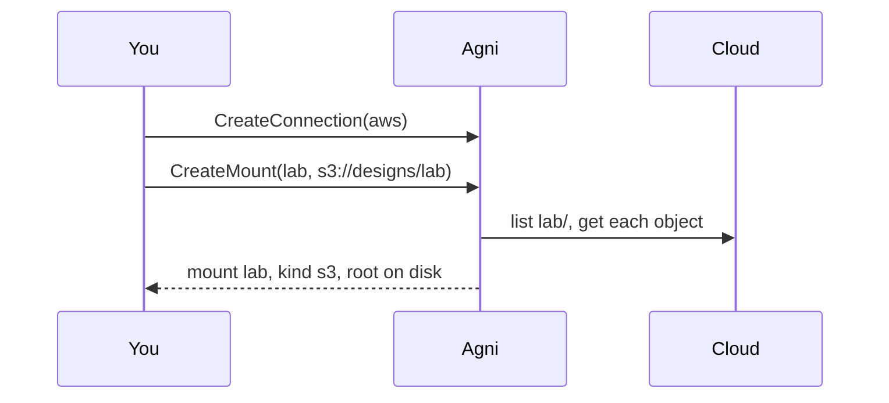
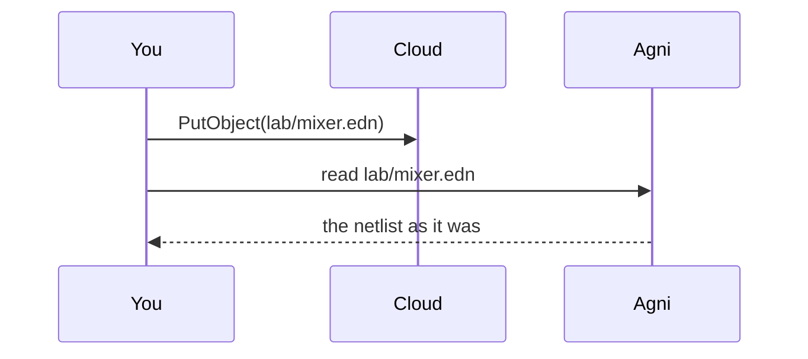

## A source is anywhere a team keeps files

A team keeps its boards in a GitHub repo, an S3 bucket, a Cloud Storage bucket, or a SharePoint document library. agni mounts each one the same way: it lists the folder, downloads every file into its uploads, and serves the files from a folder on its own disk, since the engine reads a design through a folder. This walkthrough runs against gofakes3, an S3 in the process, so it needs no account anywhere.

## Mount an S3 prefix {#bucket}

> The bucket `designs` holds a board under `lab/`. An AWS connection signs the requests, and `CreateMount` snapshots `s3://designs/lab`. The mount's root is a folder on the server holding what the bucket held.



## The mount pins what it read {#pinned}

> Someone overwrites the netlist in the bucket. The mount still serves the netlist it read, since a snapshot pins each object at its version, and a design linked through it reads the same files until it syncs. `agni serve --poll 5m` asks the bucket again on a timer, and S3 has no change events agni takes.



## A SharePoint folder is the same, with change notifications

A SharePoint or OneDrive folder mounts as `msgraph://sites/<site>/drives/<drive>/root/<folder>` through an Entra connection, which signs in as an app registration with a secret, a certificate, a managed identity or AKS workload identity. Graph can also tell the server when the drive changes. `agni mounts webhook sp --url https://agni.example.com/hooks/msgraph` subscribes the drive, the server checks each notification against `--msgraph-client-state`, and it renews the subscription before Graph ends it, about 29 days on. A notification names only the drive, so the server finds every mount in that drive, and each design that follows a folder there syncs or is marked, as after a push to a GitHub branch. Graph posts only to a public https address, so a server behind a firewall uses `--poll`.

```bash
agni connections add sp --entra-tenant contoso.onmicrosoft.com --entra-client <app-id> \
  --entra-auth secret --key env:ENTRA_SECRET --remote https://agni.example.com
agni mounts add sp msgraph://sites/<site>/drives/<drive>/root/hw --connection sp --remote https://agni.example.com
agni mounts webhook sp --url https://agni.example.com/hooks/msgraph --remote https://agni.example.com
```
