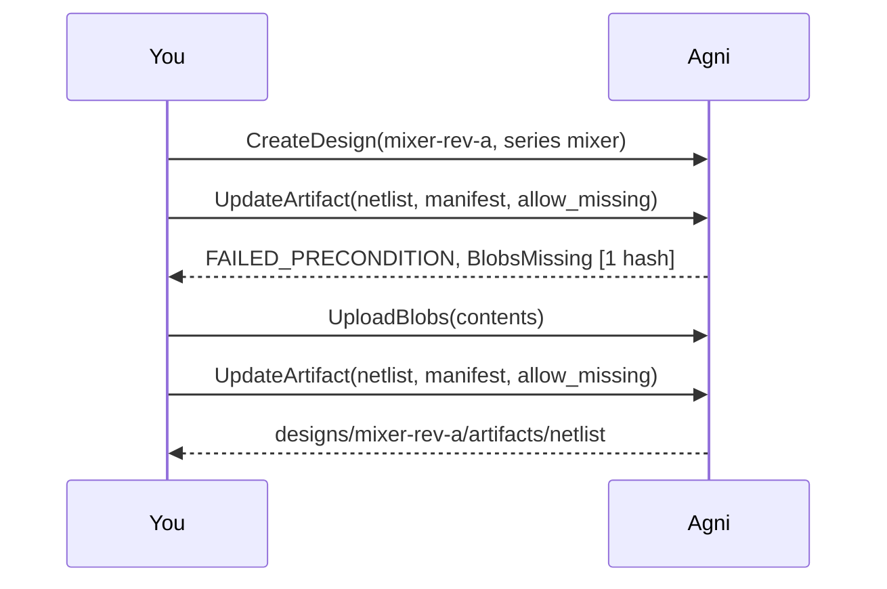
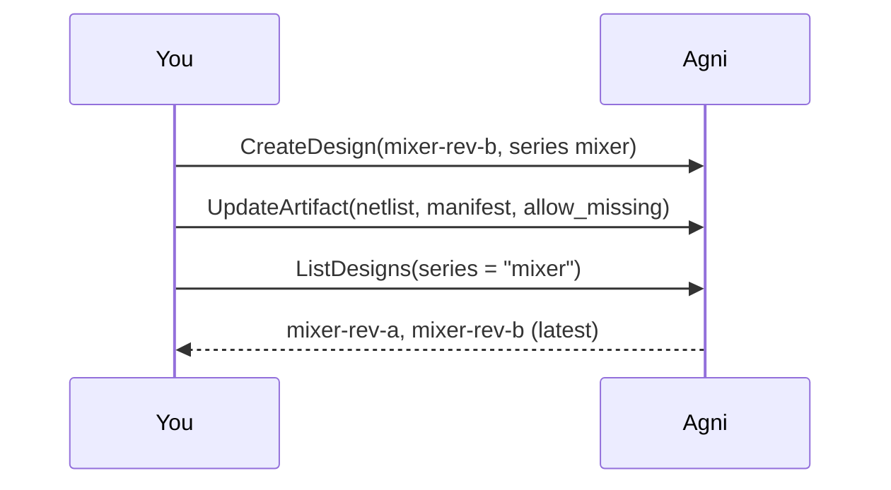
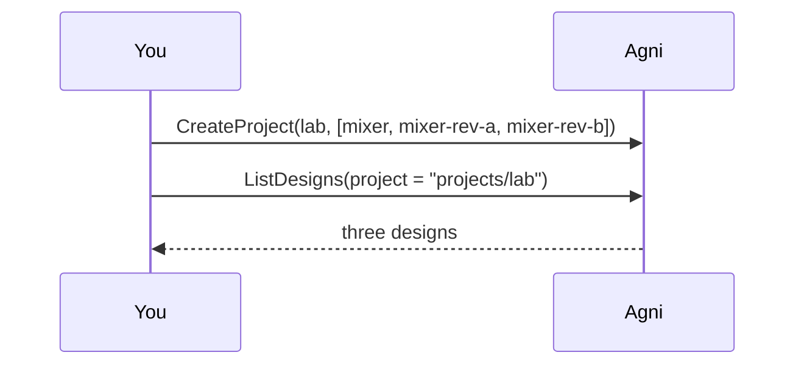
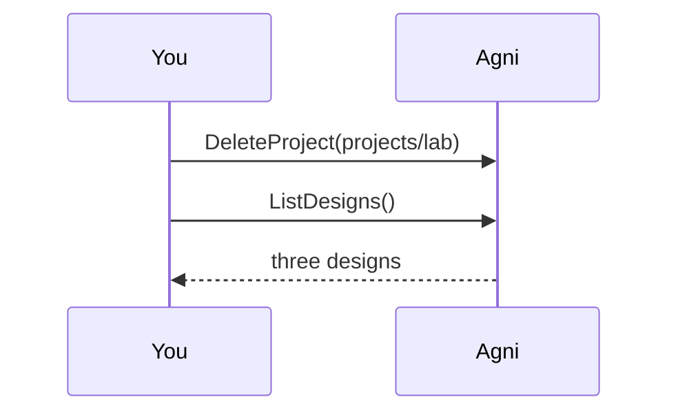

## A design is its artifacts

Picture an engineer with a board and no folder on the server. They want the server to keep the board under a name, across a restart, and to keep the next revision beside it. A server started with `--store-dir` does that (agni issue 1694).

A design is named `designs/{design}` and holds artifacts (agni issue 1696). An artifact is one source of the design, such as a netlist, a schematic with its sheets, or a board, and replacing it replaces all its files. The server reads each artifact to find its type, and writes the design's `design.yaml` itself. A design ties to no project. A project is a title and a list of design names, so one design can sit in several projects. This walkthrough builds the same two services `agni serve --store-dir` builds, over a temporary folder, with the bundled demo project mounted read-only beside it.

## Keep the first revision {#keep}

> The client makes the design with its title and series, then puts its netlist as an artifact. It sends the artifact's manifest first: each file's path, SHA-256 and size. The server answers with the contents it lacks, the client sends those with `UploadBlobs`, and asks again. A file the server already holds is never sent twice.

## Keep the next revision in the same series {#again}

> Each revision is a design of its own. The series `mixer` groups them, and the server marks the one it updated last.

## Group them in a project {#group}

> The project lists the two stored revisions and the mounted `designs/mixer` together. A design's name says nothing about where its files live, so one project can hold designs from any store.

## A mounted folder is read-only {#mounted}

> The demo project's folder belongs to whoever mounted it. The server reads it and refuses to change it, with FAILED_PRECONDITION rather than NOT_FOUND, so the caller knows the design exists.

## Delete the project, keep the designs {#ungroup}

> A project only lists designs, so deleting it deletes none of them.

