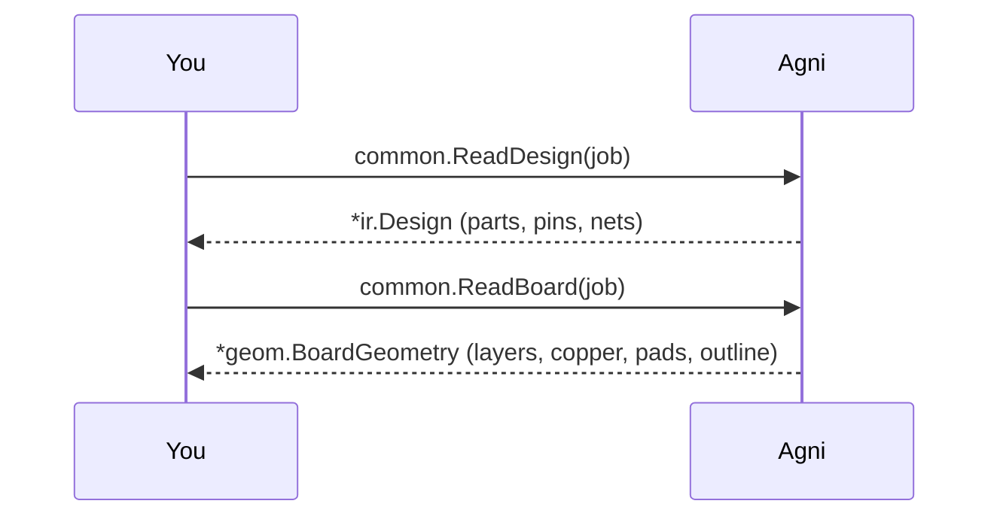

## Why a layout gets checked twice

A board leaves the design team as a schematic and comes back from layout as ODB++, the job a fabricator builds from. The two can disagree, because a layout is edited after the schematic is signed off: a part added during routing, a net renamed to suit the layout tool, a pin moved to ease a route.

We check the layout in two ways here. The first runs the rules over the layout itself, its copper included. The second compares the layout's connectivity with the schematic netlist, which is the question a layout review is mostly there to answer.

## The schematic {#schematic}

> The netlist the design was signed off as. The default is the tutorial gateway's EDIF netlist, ../common/designs/odb/gateway.edn. Any netlist agni reads works here, a KiCad schematic or a Telesis netlist included.

## The layout {#layout}

> The ODB++ job that came back. A job is a folder (with matrix/matrix inside it), or a .tgz or .zip of one, and agni takes any of the three. The default is the gateway's rev B layout, exported from its KiCad board with `kicad-cli pcb export odb`. ../common/designs/odb/gateway-layout is rev A, which matches its schematic exactly.

## Read the job {#read}

> An ODB++ job carries two tiers. The netlist comes from each part's pin records and the net each pin is on. The board is built from the copper features, and eda/data says which net each one belongs to. Both are read through the same format registry as every other file, so nothing downstream knows the layout arrived as ODB++.

## Check the layout {#check}

> The netlist rules run as they would on any netlist. The board-tier rules (copper clearance, track width) run because the job carries copper. The gateway's board has traces deliberately routed too close and one too thin, and those are the copper findings below. The I2C pull-ups rev B added still fail here, because read on its own the job has no naming conventions and PMIC_CORE_3V3 does not read as a rail. Inside the tutorial project, whose conventions declare it, both pass.

## Compare it with the schematic {#compare}

> diff matches parts by designator and nets by the pins on them, so a net the layout renamed reads as a rename rather than as one deleted and one added. Rev B's layout adds two I2C pull-ups the schematic never had, and renames the crystal nets.

## Same thing from the CLI

This walkthrough is the narrated form of two commands:

    agni check gateway-rev-b-layout
    agni diff gateway.edn gateway-rev-b-layout

One thing to expect on a real board is that ODB++ allows no spaces in a name. A net the schematic calls `/USB Hub/VBUS` arrives as `/USB_Hub/VBUS`, so diff reports it as a rename.
