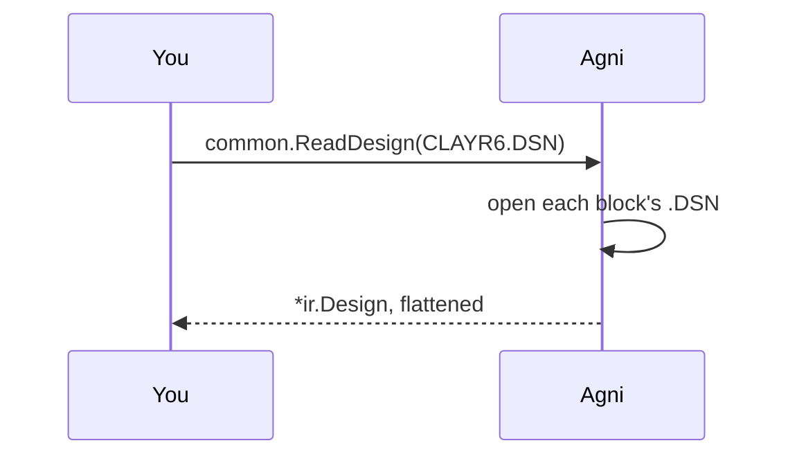

## A Capture design, read as it is saved

Capture designs usually reach other tools as an EDIF or a netlist export, and someone with a Capture licence has to make it. Agni reads the `.DSN` itself, so you can check a design you were only sent.

A Capture design often keeps each hierarchical block in a `.DSN` of its own. The top design names each block's file by a path relative to itself, and agni opens those too, so the whole design is read and not only its top page.

## Pick a design {#pick}

> The default is Clay R6, a public design by Michael Gubbels (MIT) that `make samples-oracle` fetches into tools/samples/. No synthetic Capture design can be made without Capture, so this example reads a real one. Give the path to your own top `.DSN` to read that instead, with its block files beside it as the design names them.

## Read the netlist {#netlist}

> The reader joins every pin to its net through the wire it sits on, and follows each block's ports into its parent. Each part is named by its occurrence designator, the one Capture annotated across the hierarchy and the board carries. A block whose file is missing is named in a note rather than read as empty.

## Draw the pages {#pages}

> Each page is a sheet, and each block's page sits under the page that places it. A part draws its own symbol, turned the way Capture turned it, and a power symbol or port is drawn as a symbol that names its net. Run `agni render CLAYR6.DSN --sheet 1` to draw the first block as an SVG.

## Run the checks {#check}

> The checks run over the flattened design as they run over any netlist. The schematic carries no board, so the copper rules have nothing to judge.
