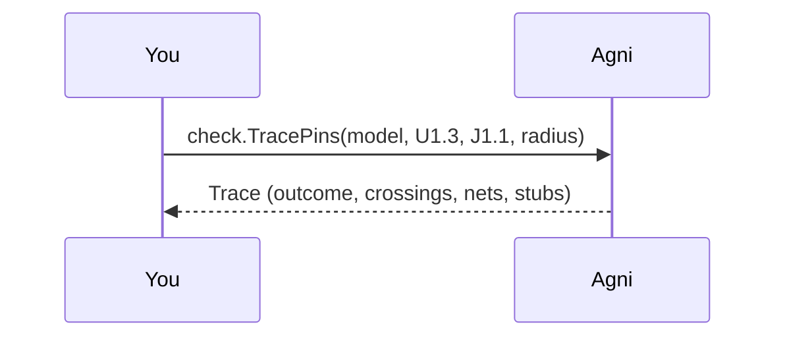

## A path is not a net

A net joins two pins. Copper connects a set of pins, and that set is the net. Put a resistor in the middle of a signal and the connection survives, but the net does not. The two ends of the part are electrically different points, so the netlist now holds two nets where a reader sees one wire.

So "is this pin connected to that one" is usually a question about a path. The path crosses however many parts happen to sit in the way, and a per-net query cannot see across a single resistor.

## Pick a design {#design}

> A path to the design, relative to this folder. The default is ../common/designs/i2c-sensor/i2c-sensor.edn. It is the entry of a declared design, and it carries an I2C bus with a pull-up resistor onto the supply rail. The other bundled fixtures live alongside it in ../common/designs/.

## Pick the two pins {#pins}

> Endpoints are pins, written as ref-des and pin designator. The defaults follow the sensor's SDA line from the device to the connector's supply pin, which runs through the pull-up.

```inputs
- name: from
  prompt: Start pin (ref-des.pin)
  type: string
  default: U1.3
- name: to
  prompt: End pin (ref-des.pin)
  type: string
  default: J1.1
```

## Walk it {#run}

> check.TracePins returns the outcome and the route from one call, so a caller cannot report a connection without the evidence for it. The walk crosses resistors, inductors, ferrites and fuses, which split a net without breaking the path. A capacitor is a DC block and is never crossed.



## Where the route stops {#terminus}

> The same trace, read for its last net. A supply rail touches almost every part on a real board, so a walk that continued through one would join everything to everything and prove nothing. The walk refuses to pass through such a net and will still stop on one, since a device pin sitting on a supply is an ordinary place to be asking about.
>
> Rail-scale is measured rather than assumed, from the global fact, the ground role, or a fan-out above the cutoff. This fixture has four pins on VCC, so it is a supply by name and not yet a rail by that measure, and the step below says which of the two reasons stopped the walk. Point the example at a real board and you get the other branch.

## When there is no route {#noroute}

> Two pins with nothing between them. This is an ANSWER rather than a failure, so it names both nets and how far it searched. An endpoint can also name nothing the design has. That is a different case, and it reports as unresolved rather than as a disconnection, because a pin spelled wrong and two pins genuinely not connected are opposite problems.

## What the start pin can reach {#reach}

> A trace answers a pair you already know. Picking the second pin is the harder part on a real board, where most pins are nowhere near the first. check.ReachablePins walks from the start pin the same way, to the same radius, and lists every pin a trace from there would route to, nearest first. Every pin it lists traces, and every pin that traces is listed, so the viewer's Trace panel offers these as targets.
>
> U1.3 reaches U2's SDA and the pull-up's near end on its own net, then the supply side one crossing away through R1. The trace's other end, J1.1, is there at one crossing. A ground or a rail on a real board is named with its pin count instead of pin by pin.

## Every pin of one part {#partners}

> A trace answers one pair of pins you already know. Signing off a part's pinout starts from the other end, with every pin of the part and the question of where each one goes. check.PartnersOf walks from each pin of U1 the way the trace walked from one. Each walk reaches some pins on other ICs and connectors, and PartnersOf lists them.
>
> SDA reaches the other device on the bus, U2. It also reaches J1's supply pin through the pull-up, and that one is left out, since a rail touches every part and would make every load a partner of every signal that has a pull-up. Pins on the supply and ground are not walked at all. `agni pinmap` writes this list as a draft pin map for a design's intent.

## Draw it {#draw}

> The route as text tells you R1 is in the way. It does not tell you where R1 is, what else hangs off the nets on either side of it, or whether you got the path you meant. check.TracePins hands back the nets and the parts crossed. A highlight overlay takes exactly those subjects, so drawing the answer is a conversion rather than a second walk.
>
> This writes route.svg beside the example. Open it in anything that shows an SVG. The design's own schematic is drawn where it has one, and an auto-layout of the netlist where it does not, and the step says which, so you never mistake the second for the first.

## Same thing from the CLI

This walkthrough is the narrated form of one command:

    agni trace ../common/designs/i2c-sensor --from U1.3 --to J1.1 --render route.svg

Add `--hops` to widen the search, and `--format json` for the machine-readable form. The reach step
is the same command with `--reachable` in place of `--to`:

    agni trace ../common/designs/i2c-sensor --from U1.3 --reachable

The every-pin
step is this command. It writes its answer as a draft io_map for `agni check --intent-path`:

    agni pinmap ../common/designs/i2c-sensor --device U1

To look at the whole design interactively rather than one route, `agni open
../common/designs/i2c-sensor` serves it and prints a URL.
