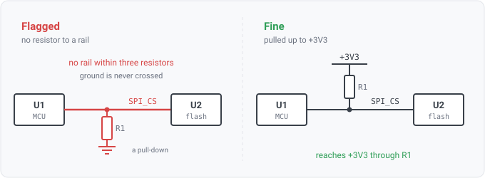

## missing-pullup

### What it means

The profile marks some signals as needing a pull-up, such as a chip-select or an open-drain line.
The rule reports such a signal when its net reaches no power rail through a resistor, so no pull-up
sits in its path.

### Why engineers want it

An open-drain or chip-select line with no pull-up floats between drives. At power-up, before any
driver takes it, it can sit at an undefined level and select or clock the device spuriously. The
pull-up holds it inactive.

### How it is checked

It runs the bounded walk that the built-in `i2c-pull-up` uses, by calling it directly rather than
approximating it. The walk goes from the signal net out through resistors, for up to three
crossings, looking for a rail. A rail is a legal DESTINATION and never a transit node, and ground
is never crossed at all. A resistor to ground is a pull-down, and counting it would pass exactly
the line that this requirement exists to catch.

**The finding and the pass both carry the path.** A pass says "SPI_CS reaches rail +3V3 through R1"
and hands the viewer the resistor and the rail as clickable entities; a failure says no rail is
reachable within the hop limit, and names the limit, because "no pull-up" and "a pull-up four hops
away" are different situations, and a bare message cannot tell them apart.

Of the profile requirements, only this one compiles to Go rather than to a query, and the previous
paragraph shows why. Datalog could state a reachability question but could not name what the walk
crossed. So the profile route proved a pass with the net's own name, while the built-in proved one
with the route (agni issue 516). Calling the same function makes the two reports identical rather
than merely similar.

So the same datasheet credit applies here too. If a part's datasheet binds an internal pull-up to a
pin, the pin passes, citing the row (agni issue 1298). The MNT Reform's SD lines are pulled up
inside its TXS0108E level translator this way.

### For software readers

A pull-up works like a default value, and without it the line has no defined idle state, the
hardware analogue of reading an uninitialised variable. The rule checks that the default is wired in.
