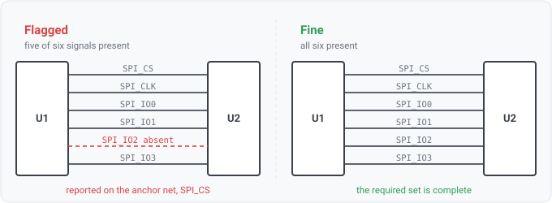

## signal-missing

### What it means

An interface profile lists the signals that a bus must have. This fires when the interface is **in
use**, meaning its anchor signal (e.g. SPI-NOR's chip-select) and at least one other signal are
present, but a required signal net is absent. Signals are matched by net name, usually by suffix,
though a profile may also match by prefix, glob or regex. On a design that declares a host,
`host-incomplete` reports instead and this rule stands down.

The shipped eMMC profile has an `instance` key, and a profile with that key asks this of each bus on
its own. A bus is the nets named from one anchor net's stem, so `SD2_CMD`'s bus is `SD2_CLK`,
`SD2_DATA0` and so on, and a signal on another bus does not count. A bus that carries one of the
profile's `excludes` lines is a different interface, and the rule does not check it. A removable SD
card's slot has a card detect line, so the eMMC check leaves the slot out.

### Why engineers want it

The most common bus-wiring slip is a forgotten line, with five of six SPI-NOR signals wired and one
missed. Each "verify signal X connected" review item is really this one check applied per signal.
The profile encodes the required set once, and the rule flags whichever member is missing.

### Why it anchors on a present signal (and what it does not catch)

A datalog rule fires on rows; an absent net is not a row. So "IO2 is missing" is reported against
the interface's **anchor** net (which is present), one finding per missing signal. When the anchor
itself is absent, on a wholly-missing interface, there is nothing to anchor on and the rule is
silent, by design. To detect a required interface that is entirely absent, you need a declared host
or a design-intent `modules` declaration (`intent/module-missing`), not a name convention.

### For software readers

The profile is an interface/protocol definition, and this rule checks that an implementation
provides every member that the interface declares. "Anchored on a present signal" is like validating a
partially-filled config, where you can flag the missing keys only once you can tell the config is
meant to be there at all.
