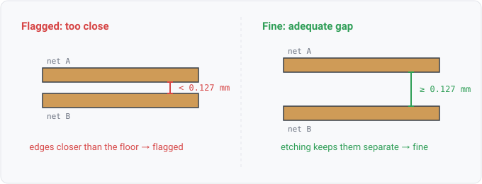

## copper-clearance

### What it means

Copper of two different nets on the same layer comes too close: a track against a track, a track
against a pour, or a pour against a pour. A track's edge distance is its centerline distance minus
half its width. A pour's edge is its outline and the edge of each of its holes, so a track in a
pour's clearance hole measures against the hole's edge. Copper lying wholly inside another net's
pour is a short, reported with a gap below zero. Too close means under the minimum clearance the board declares. When the board declares
none, the floor is 0.127mm (5mil), the loosest mainstream fab's minimum spacing (the corpus JLCPCB
rules).

### Why engineers want it

Clearance is the other half of every fab capability sheet.
Below it, etching cannot guarantee separation and solder bridges what etching spared, so
the board acquires connections the schematic never had.

### Impact

Order-time rejection at best; intermittent shorts in the field at worst.

### Scope note

The floor follows track-width's posture. A board that declares its own minimum is held to that instead, because the declaration is the designer saying which process the board is routed for. Today that is a KiCad project's `board.design_settings.rules`, read whichever of the project's files names the design, and every finding names which of the two it was measured against (agni issue 933). A gap may sit up to 0.0005mm under the floor and still meet it. That margin is
KiCad's own DRC epsilon. The distance between two diagonal tracks is not a whole number of
nanometres, so copper routed exactly at the minimum measures a nanometre or two under it.

The rule measures tracks and pours on one layer, and same-net spacing is not a defect. A pour is
the copper a board file stores as copper, which Allegro, Altium, IPC-2581 and ODB++ boards carry
(agni issues 1357, 1410). A KiCad board stores the outline a zone is filled from and not the fill,
so its zones are not measured; its ODB++ export is. A gap to a pour's edge may sit up to 0.005mm
under the floor, because a file writes a pour's curved edge as short straight runs that cut inside
the curve by up to that much, KiCad's own arc tolerance. Pads and vias are not measured yet.

Tracks are swept in x order per layer (agni issue 963). A plane can have tens of thousands of
edges, so pour edges sit in a 1mm grid per layer instead, and each track looks only at the cells
within its reach. On Jetson's ODB++ export, with 523,591 pour edges, the rule takes about 0.75s.
BenchmarkCopperClearance tracks the cost. The rule gives one verdict per net PAIR, naming both nets. The finding's subject is the
alphabetically first net, with the other as context, and its message names both and the worst gap.

### Query structure

the pairwise spatial join, which the Phase-1 AST does not express:

    select (S1, S2) in (board.segments + board.pour_edges) x (board.segments + board.pour_edges)
      where net(S1) != net(S2) and layer(S1) == layer(S2)
        and edge_distance(S1, S2) < floor - tolerance(S1, S2)
    union
    select (T, P) where T is a track or pour lying inside pour P of another net

where tolerance is 0.005mm when either side is a pour edge and 0.0005mm otherwise.

The floor is the declared minimum clearance, else 0.127mm.

Reads: board.copper, board.rules. Tier P. Primitives: select, geometry-distance (candidate primitive,
not yet in the AST, and this rule is its evidence).