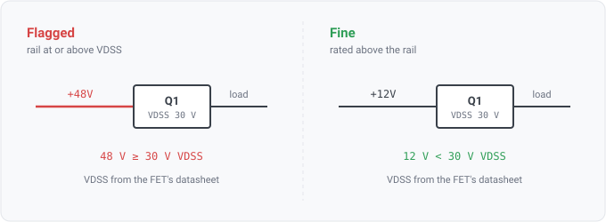

## fet-vdss-below-switched-rail

### What it means

A MOSFET sits on a power rail, and the rail's voltage is at or above the part's datasheet
**drain-source breakdown** rating (VDSS). When the rail's voltage comes from a datasheet, both
numbers are vendor values, and the finding cites each one it used.

### For hardware engineers

VDSS rates how much voltage a FET can block across drain and source while it is off. Past it the
part stops being a switch. It avalanches, conducts when it is meant to block, and often fails
**short**.

The rule reports an error rather than a warning because of the short. An open failure disconnects
the load, which is visible and usually harmless. A shorted high-side switch hands the full rail
straight to whatever it was protecting, so the part chosen to protect the load destroys it instead.
The vendor does not stand behind a 30V-rated FET on a 48V rail.

In a real design, rating a switch above the rail is not enough. Inductive kickback and hot-plug
transients push the drain well above the nominal rail, so designers derate. This rule only catches a
part under-rated against the **steady-state** rail, because that half is unambiguous.

### Where the rail voltage comes from, and why the message says so

Two sources, preferred in this order:

1. **A driving part's datasheet output** comes first. If something on the rail declares an output
   voltage in its spec, that is a vendor value. It gets its own citation, and the review's
   data-trust gate weighs it alongside the FET's.
2. **The net's name** is the fallback, since `+5V` means 5V by convention. That is a design convention, not a document, so
   it gets no citation.

The message names which was used. A datasheet's `5V` deserves more trust than a `5V` inferred from
a net name, and a report that flattened them would overstate what it knows.

### Precision limit

VDSS is a rating on the **drain-source** pair specifically, and the naming lexicon now resolves a
transistor's gate, source and drain (WS3-117), but this rule does not read them yet. So it cannot
tell which of the FET's nets actually sits across those terminals.

It therefore compares against every **rail** the part touches, one verdict per (FET, rail) pair.
Filtering to rails rather than every net is right, because a gate-drive net is not a rail. The
obvious false pairing is then excluded structurally rather than by luck.

The residual case is a gate deliberately tied to a rail (an always-on FET, or a P-FET gate pulled to
its source). There the binding limit is VGSS, not VDSS, and VGSS is usually far lower. The
condition is typically still a defect, but this rule would name the wrong parameter for it. Reading
the WS3-117 terminal roles would make the rule exact.

### For software readers

The rule joins two projections, and before it each was read on its own. One is the part's
breakdown rows (`FetBreakdownLimits`). The other is the rail's voltage, resolved from either a
driving part's `OutputVoltageLimits` or `RailMaxVoltage`'s name-derived nominal.

Where several rows are comparable the rule takes the **lowest** breakdown (a part is endangered at
its weakest rating) against the **highest** rail voltage. Any other pairing under-reports.

`DatasheetProv` holds one citation or two, depending on the rail's evidence. WS3-028 added the
plural citation field for this case. The data-trust gate rates a finding by its weakest citation, so
a rail voltage from a low-confidence extraction correctly drags the whole finding to Provisional.

### When it reports no finding

- **With no seeded datasheet set**, the rule has no params tier to read, so `check.Available` gates
  it to not-applicable without `--params`. Unevaluable, never clean.
- **The FET is unseeded**, or its spec carries no breakdown row. Each (FET, rail) pair reports
  not-considered with that reason, never a pass.
- **The rail's voltage is unknown**, because no driving part declares an output and the name carries
  no voltage token. A rail named `VSYS` yields no number, so the pair reports no-limit and the rule
  does not guess one.
- **Ground is excluded explicitly**, because it is a rail by the engine's definition but carries no
  voltage to compare. A ground net gets no verdict.

### Fixing a finding

Either the FET is under-rated for where it sits, or it is on the wrong rail. Check the intent before
swapping the part. The rule reports the FET because the FET carries the rating. A switch wired onto
the wrong rail is a netlist error, not a part-selection one.
