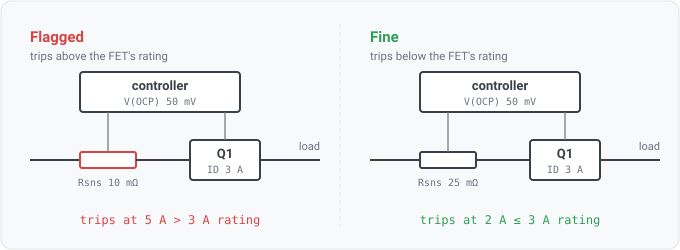

## load-switch-trip-above-fet-rating

### What it means

A load switch is built from a **switch controller**, an **external MOSFET** and an **external sense
resistor**. The controller trips at a current higher than the MOSFET's continuous rating.

Both numbers are vendor values and the finding cites the page each came from. The third input, the
sense resistance, comes from the design, because no datasheet knows it.

### For hardware engineers

An integrated load switch is one part. Its current limit and its pass element are specified together
by one vendor, in one document, and they already agree.

A controller-based switch is three parts chosen by three separate decisions:

- The **controller** states a sense threshold, a voltage such as 50mV. That is all it states. It has
  no current limit of its own, because it has no idea what shunt you will put in front of it.
- The **sense resistor** turns that threshold into a current. `ITRIP = V(OCP) / Rsns`. A 50mV
  threshold across 10mΩ trips at 5A; across 50mΩ it trips at 1A. Same controller, five times the
  current.
- The **MOSFET** carries that current, and has its own continuous drain rating.

Nothing in the design flow checks that the third number is bigger than the first two put together.
When it is not, the current limit does nothing useful. The FET reaches its own rating while the
controller is still comfortably below its trip point. The protection existed for the FET, and the FET
dies. A high-side MOSFET that dies usually dies **short**, and then the whole rail reaches the load
it was switching.

The effective on-resistance of such a switch is likewise the external FET's RDS(on), not any number
on the controller's sheet. The finding reports it, because the reviewer's next question is "what
does the FET dissipate at the trip current".

### What derating this does and does not cover

The rule compares against the FET's **printed** rating, which is a 25C figure. Real designs size well
under it. A trip point that sits below the printed rating therefore passes here and may still be
badly derated.

The rule checks the unambiguous half on purpose. "The current limit is set above the vendor's own
number" is a defect nobody argues with. "The current limit is set at 80% of the vendor's number and
the part is in still air behind a connector" is a thermal argument, and this rule does not attempt
it.

### How the three parts are found

- **The FET** is a transistor whose **gate** terminal is on exactly one net. The role comes from the
  naming lexicon's role vocabulary, so a house that calls its gate `DRV` declares that in
  `--conventions` rather than patching the engine.
- **The controller** is the single non-transistor part on that gate net whose datasheet states an
  overcurrent threshold. The rule identifies it by what its sheet says rather than by a device-class
  keyword, so a part that declares a sense threshold is a current-limiting controller, whatever its
  description string reads. This also settles integrated-versus-controller for free, since an
  integrated switch has no external gate net to be found from.
- **The sense resistor** is the single resistor where the controller also touches **every** one of
  its nets. This is Kelvin sensing, expressed structurally. Two dedicated pins measure a shunt, one
  on each of its two terminals. A series part that merely sits nearby has a far terminal, and the
  controller does not touch it.

A feedback or programming divider between a controller's output and its sense pin shares that
structural signature. Their values differ by orders of magnitude. A shunt drops tens of millivolts
at amperes, so it is milliohm-class. A divider must not waste current, so it is kilohms. One ohm sits
in the empty middle, so the resolver accepts only a resistance of **1Ω or less**.

### When it reports no finding

No finding always means "I could not tell", never "this is fine".

- **With no seeded datasheet set**, `check.Available` gates the rule to not-applicable without
  `--params`.
- **The gate net carries two candidate controllers**, or the controller has **two candidate shunts**.
  Unresolvable, so no verdict rather than a verdict computed from the wrong part.
- **The FET's gate is on more than one net**, or it declares no gate pin at all.
- **The controller states no overcurrent threshold**, or states it in a unit the parameter layer
  does not recognize. Real controller sheets print this row in millivolts, so a millivolt row is
  reduced to volts and compared. A unit with no entry in the conversion table is skipped rather than
  scaled by a guess, so the rule still fails toward silence instead of toward a current a thousand
  times too large.
- **The FET is unseeded** or states no continuous drain rating. The FET then reports not-considered
  with that reason. Pulsed drain current is deliberately not accepted in its place.
- **The shunt's value is not stated in ohms in the design.** The reader may never have normalized a
  component's value, or normalized it without a unit. Either way the value is no evidence of a
  milliohm shunt. This is the live limit on formats. The loader's value pass (`classify.StampValues`)
  recognizes only a few property spellings (`value`, `val`, `partvalue`, `component_value`). An EDIF
  exporter may spell the property otherwise, and then the design carries no readable number and the
  rule reports nothing there.
- **A zero-ohm shunt is skipped**, because dividing by it gives infinity, which every comparison
  downstream would read as an enormous current and report as a defect.

### For software readers

The rule joins two things that had no prior arithmetic between them. `check.ExternalFetLoadSwitches`
resolves the topology and the trip current; the rule adds the rating comparison.

The trip current is the first calculation in the engine to cross two units (WS3-085). It goes
through `check.OhmsLawCurrent(volts, ohms) (amps, ok)`. That function is a named physical operation
rather than a general dimension algebra. Every other consumer compares within one unit, and the
accessors already gate that, so a dimension system would be a lot of machinery with no second
caller. The signature states the unit contract, and `ok` is false for a non-positive or non-finite
resistance.

`DatasheetProv` carries exactly two citations, the FET's rating first (the endangered part) and the
controller's threshold second. The on-resistance is quoted in the message with an inline citation but
is **not** in `DatasheetProv`. The verdict does not depend on it, and the review's data-trust gate
rates a finding by its weakest citation.

### Fixing a finding

Three levers, and they are not equivalent:

1. **Raise the shunt's resistance** to bring the trip current down. Cheapest, and it costs a little
   more dissipation in the shunt.
2. **Choose a FET with a higher continuous rating.** Right answer when the load genuinely needs the
   current.
3. **Choose a controller with a lower threshold.** Rarely the lever, since the threshold is usually
   fixed by the part.

Check which of the three numbers was the intended one before changing any of them. The rule reports
the FET because the trip current exceeds the FET's rating, not because the FET is necessarily the
wrong part.
