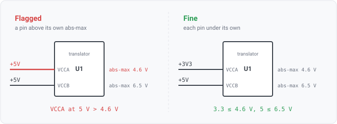

## pin-exceeds-abs-max

### What it means

A component is joined to a seeded datasheet spec, and one of its supply pins is on a rail. The
rail's name states a nominal voltage above **that pin's own** absolute-maximum rating. The rating
comes from a limit row that the datasheet binds to that terminal.

### Why engineers want it

A part can have several supply pins rated differently. A voltage translator sits between two
domains and has one supply per side, commonly 1.2 to 3.6 V on one and 1.65 to 5.5 V on the other,
with absolute maxima to match. Asked about the PART, the absolute-maximum question has no single
right answer.

`supply-exceeds-abs-max` answers it by taking the most restrictive row and applying it to every
supply pin. That is conservative. On a part whose terminals genuinely differ, it is wrong in the
direction that costs a reviewer the most. It checks the 6.5 V terminal against the 4.6 V one and
reports a violation where there is none. This rule compares each terminal against the limit that
its own datasheet row states, so a correct design stops being flagged and a real breach names the
pin it is on.

### Relationship to supply-exceeds-abs-max

They never both fire. This rule acts only on a part whose spec carries pin bindings, and
`supply-exceeds-abs-max` defers on exactly those parts. The alias path answers everything else
exactly as before, including every spec seeded before pin binding existed.

### What it skips rather than guesses

Every input that cannot be trusted is a skip, never a guess:
- no MPN, unseeded MPN, no seeded set, or a spec with no pin bindings -> this rule is silent and
  the alias path answers instead;
- a design pin that does not resolve to exactly one spec pin -> skipped. Resolution leads with the
  pin NAME, uses the designator only to break a tie inside an identified package, and REFUSES when
  the two disagree or when a shared name cannot be separated. A guessed terminal would produce a
  confident finding about the wrong thing;
- a supply pin on no net, or one that the datasheet binds no comparable row to -> skipped;
- limit rows that are under-specified or carry text-only conditions are not compared
  (param.MachineComparable);
- a rail name with no parseable nominal, or with conflicting nominals, is not compared.

### Query structure

join components to specs by MPN, resolve each supply pin onto a spec pin, and compare the rail's
nominal against the abs-max rows bound to that pin.

    select C in components where spec(C) has pin bindings
      for P in pins(C) where electrical_type(P) == power_in
        S = resolve_pin(spec(C), name(P), designator(P), package(C))   -- may refuse
        for R in abs_max rows bound to S
          nominal(net(P)) > max(R) -> finding

Reads: param.pin, param.pin_range, pin.electrical_type, net.name, on_net. Tier R.
