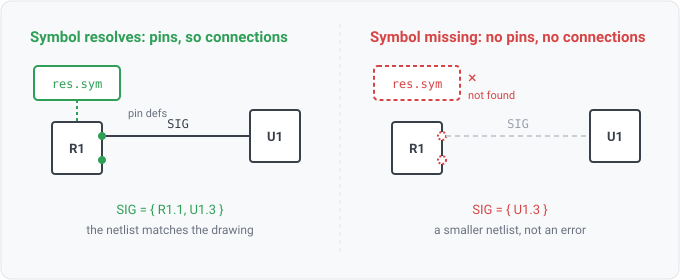

## symbol-unresolved

### What it means

The reader could not open or parse a symbol reference, such as an xschem or gEDA `.sym` file or a
KiCad external `.kicad_sym` library named by a `lib_id` that the schematic does not embed. The
schematic itself parsed fine. Only the file holding the part's pin definitions is missing.

### Why engineers want it

A symbol carries a part's terminals. When it fails to load, the placement keeps its reference
designator and gains no pins, and a part with no pins has no connections. So the netlist is missing
every connection those parts make. Nothing about the result looks wrong, since the design reads as
valid and simply emptier than it is.

A missing library produces a smaller netlist rather than an error.
Connectivity rules then run over the incomplete read and report a clean pass. That pass reads the
same as one on a design where those connections were never drawn.

### Impact

Every connection made by the affected parts is absent from the netlist. The reader makes this worse
by design. Whenever any symbol fails to resolve, it suppresses dangling-endpoint findings, because a
missing pin turns a real wire end into a phantom dangle. Without this rule, the only visible effect
of a lost symbol is that the design reports LESS than it would have.

### What it does to other rules

If any symbol is unresolved, a rule that reads a pin or connectivity fact reports `inconclusive` on
every subject a lost pin may change, rather than passing over an incomplete netlist (agni issue 88).

The reader finds those subjects from the drawing. A lost symbol takes its pins with it, so each wire
end, label or pin drawn to one of them is left alone at its point. The reader lists the net of every
such lone point as `nets_missing_pins`. The gate then reaches three kinds of subject:

- a lost part, or a pin on one
- a listed net, or a net within three series crossings of one, the reach the power-entry walk uses
- a part with a pin on any of those nets, and a verdict whose proof names any of them

Every other subject keeps its verdict. On Glasgow, deleting one library symbol at a time gates
between 5 and 1,064 of about 2,300 connectivity verdicts and keeps the rest.
`TestTheUnresolvedGateCoversEveryVerdictALostLibraryChanges` checks each such read against the full
one, and every verdict that differs is inconclusive.

The list can name more nets than the loss reaches, since a real dangling end and an unconnected pin
are alone at their points too. It cannot see a lost pin drawn onto a bend between two wire ends, and
the oracle above is how a case like that would show up.

Two cases stay design-wide. A reader that does not supply `nets_missing_pins` gives no basis for
keeping any verdict, so every subject of every connectivity rule is inconclusive. A rule that reports
only its failures cannot have its silence on one subject gated, so its findings are replaced by one
inconclusive finding.

A rule that reads only net names is not gated. KiCad names an unlabelled net after one of its pins,
so losing that pin renames the net, and such a rule judges the name the read has.

The outcome is `inconclusive` rather than `not-applicable`. A missing source-format capability is
permanent. An unresolved symbol is a property of THIS read, and a `--symbol-path` can fix it.

### The one subtlety

The severity is warning, though the effect on the netlist is as corrupting as a ref-des collision,
which is an error. The difference is whose fault it is. A collision is an annotation slip in the
design. An unresolved symbol is almost always a defect in the invocation: no `--symbol-path`, a
library not checked out, a file not mounted. The board itself may be flawless, and every FAIL is
supposed to be a defect in the design.

A read without symbols at all reports nothing. That read is the plain `Read` entry with no opener.
It means a caller deliberately asked for names only, and it is not a resolution failure.
