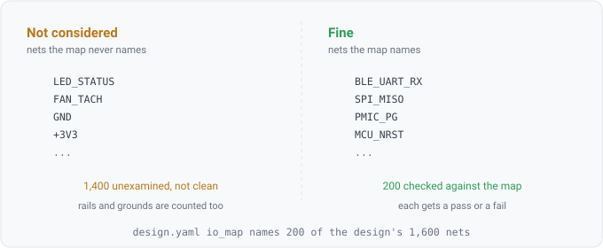

## io-map-coverage

### What it checks

It reports which nets in the design the IO map declares, and which it says nothing about, with one
verdict per net.



**Nothing here is a defect.** A net the map does not name is a question nobody asked, not a fault in
the board. The rule exists so the count of such nets is visible rather than absent.

### Why coverage is the number that matters here

Imagine a design with sixteen hundred nets and a map declaring two hundred of them. Two hundred nets
are checked and fourteen hundred are **unexamined**. Unexamined is not the same as clean. If the rule
reported only the two hundred, the result would be green about a fraction of the board, and the
output would not say how large that fraction is.

This rule is the other half of a pair. The two look alike and report opposite defects, so they get
confused constantly.

| | usually means | reported by |
|---|---|---|
| the map declares a net the netlist does not have | a real disconnection | `intent/io-map-net-absent`, as a fail |
| the netlist has a net the map does not declare | an incomplete map | this rule, as `not-considered` |

### Rails and grounds are counted, and said so

A pin map does not usually name `GND` or a supply rail, and on a real board those are a large share
of the nets. They are still counted in the denominator, and their verdict says which they are.

Carving them out would mean the tool decides which absences are acceptable, and that judgment
lets a real gap hide. Imagine a map that forgot an entire peripheral bank. It would read as
well-covered if the arithmetic quietly excused a third of the board. So the rule names them in the
reason instead. A reader can then tell them apart, and the tool makes no call.

### Reading the result

The rule heading carries the whole tally, so the coverage number is the heading and not something to
count by hand:

```
intent/io-map-coverage  47 pass, 1553 not-considered
```

The per-net rows are the addressable form of the same thing, so a specific net can be asked about
rather than only the total. In the terminal the row list is capped, with the elided count stated; the
heading is always complete.

### Declaring it

Nothing extra. It reads the same `io_map` section the other three rules read, and it is compiled
whenever a map is declared.

### Fixing a finding

There is nothing to fix in the design. Either declare the nets the map does not cover, or accept the
coverage and read the other IO-map results as being about the covered fraction alone.
