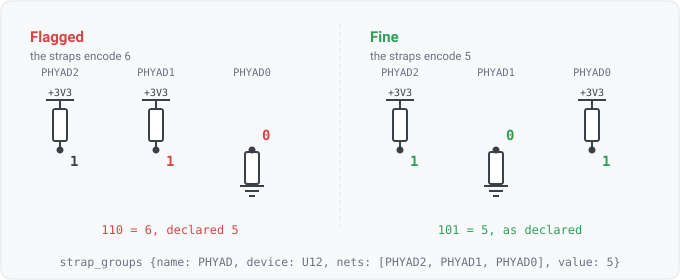

## strap-group

### What it checks

It reads several strap nets together as one binary number, MSB-first, and compares it against the
design intent's declared value, such as a device's address on a shared bus, its boot source or its
bus width.



`property-strap` asks whether one pin latches the intended level. This asks whether the pins
*together* encode the intended number. A per-net declaration has no vocabulary for that. Nothing
ties `PHYAD2/1/0` together as one value, and nothing says which device they belong to.

### For hardware engineers

Getting one bit of an address wrong does not look like a wiring fault. Each resistor is individually
plausible, the board powers up, and the part answers on the wrong address. On a shared bus that is
either a device nothing can talk to, or worse, a device that collides with another one.

The finding names the bits it observed and where each came from, so you can go to the schematic and
compare against the part's strap table rather than re-deriving the number.

### Partial evidence, and why it is reported rather than assumed

A strap pin almost always carries an internal pull, and the standard datasheet instruction is to fit
an external resistor **only for the non-default state**. So a 3-bit address commonly has resistors on
only one or two bits, and that is a correctly built board.

Those unbiased pins are not unknown to you. They sit at the part's internal default. But the netlist
does not record that, so the engine cannot read it.

**Declare `default` and the group decodes.** It states which level an unbiased pin in this group
takes. That is the one fact the netlist is missing.

**Without it, the group reads `inconclusive`**, naming the pins it could not read. It is not decoded
with the missing bits assumed zero, because that would invent an address, and an invented address can
invent a collision, turning a silent gap into a confident accusation about two parts that are fine.

### Declaring it

```yaml
strap_groups:
  # every bit carries a resistor: decodes with no default needed
  - {name: PHYAD, device: U12, nets: [PHYAD2, PHYAD1, PHYAD0], value: 1, bus: MDIO}
  # only PHYAD0 is fitted; the rest sit at the part's internal pull-down
  - {name: PHYAD U13, device: U13, nets: [PHYAD2, PHYAD1, PHYAD0], value: 4, bus: MDIO, default: low}
  # a mode select, not an address: no bus, so it is exempt from collision checking
  - {name: boot mode, device: U1, nets: [BOOT1, BOOT0], value: 2}
```

`nets` is **MSB-first**, and the order is the declaration's job, because nothing in a netlist states
which pin is the high bit. A rule could infer bit order from names, but that would be a naming
heuristic, and this codebase moved those out of rule literals.

`value` must fit in the declared bits. If the group could never encode a value, the value is
rejected at load, since it would fail on every design including a correct one.

`bus` scopes collision detection. Omit it for a group that is not an address on anything shared.

### Absence is not a pass

If a declared net is missing from the design, the presence forms handle it, and the group reads
`not-considered` here, naming the net. If the group's value cannot be read, the group reads
inconclusive, which counts as covered and never as passing.
